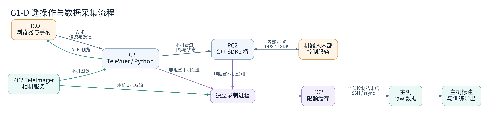
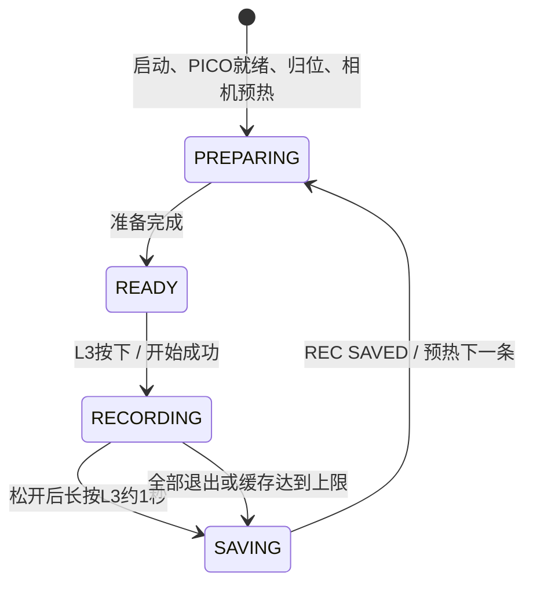

# G1-D PICO 遥操作与实验室数据采集：项目说明

核对日期：2026-11-01。

本项目面向实验室内的人工遥操作数据采集：用 PICO 4 Ultra 控制 G1-D 的底盘、立柱、腰部、双臂与 Dex3-1 三指手，记录图像、机器人状态、控制目标、操作输入和日志，供后续模型训练使用。

本文按当前本地主机源码和配置核对，覆盖 PC2 直接控制、PICO 操作、L3 分段录制、自动日志、训练数据 v2、主机标注与导出。PC2 实际运行的是同步过去的代码和在 PC2 编译的程序；修改主机文件不会自动更新机器人。

开源地址：`https://github.com/wwwxx2333/Proj_PICO_G1-D`。
G1-D上PC2地址：`/home/unitree/Proj/Proj_PICO_G1-D`。

日常使用可先看第 3～5 节；维护代码看第 6～8 节；使用采集数据看第 9～13 节。首次配置环境见第 2 节，异常处理见第 14 节。

## 1. 设备组件

| 设备/组件 | 职责 | 使用方式 |
|---|---|---|
| PICO 4 Ultra | 浏览器显示机器人头部画面；发送头显、两个手柄位姿和按钮/摇杆数据 | 与 PC2 在同一 Wi-Fi |
| G1-D（PC2） | 运行 TeleVuer、Python 控制、IK、C++ 桥、独立录制与日志进程 | 已使用的无线地址 `192.168.1.118`；内部 eth0 为 `192.168.123.164` |
| G1-D（PC1） | 机器人内部控制服务，接收 SDK/DDS 控制请求，提供底盘、关节等反馈 | 通过 PC2 内部 eth0 接入 |
| TeleImager | 已有相机服务，提供头部和两侧腕部图像 | PC2，原有 `tv` 环境（已在环境中，不用管） |
| 主机 | 开发、编辑配置、SSH 终端、结束后拉取数据、标注和离线导出 | linux系统，或者windows+WSL |

上述 IP 是本项目当前使用的地址。PC2 的 DHCP 地址变化后，SSH、PICO 页面和 HTTPS 证书都要匹配新地址。日常控制不要求登录 PC1。

组件工作流：


机器人运动控制不经过主机逐条转发。主机和机器人之间无需外接网线；机器人内部 eth0 仍保留。SSH 用于登录和查看输出，不承载 SDK 运动指令。采集期间没有新增图像上传到主机的线程，但 PICO 输入和预览仍使用 Wi-Fi。


<a id="installation"></a>

## 2. 环境、首次准备与更新


### 2.1 G1-D机器人PC2准备

#### 2.1.1 有线连接
首次可使用以下任一种方式：

- 主机用网线连接机器人开发网口，再通过 SSH 登录 PC2。
- 在 PC2 的本地显示器/键盘终端操作。

使用网线时，把**主机连接机器人那块网卡**设为：

```text
IPv4 地址：192.168.123.222
子网掩码：255.255.255.0（/24）
默认网关：留空
DNS：留空
```
在**主机终端**登录：

```bash
ssh unitree@192.168.123.164
```

这里的 `.164` 是本台机器人此前确认的 **PC2 内部地址**，不是所有 G1-D 的通用保证值。若无法登录，应先从设备资料或 PC2 本地终端确认地址；不要把 PC1 的 `.161` 直接当成 PC2 登录地址。

登录后确认身份和平台：

```bash
whoami
uname -m
ip -4 -br addr
```

应看到用户 `unitree`、架构 `aarch64`，以及原有的内部网卡 `eth0`。以下无线配置命令只操作 `wlan0`，不修改机器人内部 `eth0`。

#### 2.1.2 无线连接配置

**执行位置：PC2，保留当前有线 SSH 或本地终端。**

```bash
nmcli device status
sudo nmcli radio wifi on
sudo nmcli device wifi rescan ifname wlan0
nmcli device wifi list ifname wlan0

sudo nmcli --ask device wifi connect 'WIFI名' ifname wlan0
```

按提示输入 Wi-Fi 密码。`--ask` 的用法见 [NetworkManager 官方示例](https://networkmanager.pages.freedesktop.org/NetworkManager/NetworkManager/nmcli-examples.html)。成功后会打印连接已激活。

把当前 Wi-Fi 配置设为开机自动连接，并查看新地址：

```bash
wifi_profile=$(nmcli -g GENERAL.CONNECTION device show wlan0)
sudo nmcli connection modify "$wifi_profile" connection.autoconnect yes
ip -4 -br addr show wlan0
ip -4 -br addr show eth0
```

例如：

```text
wlan0  UP  192.168.1.118/24
eth0   UP  192.168.123.164/24
```

`wlan0` 是外部无线通信，`eth0` 是机器人内部通信，两者保留不同网段即可。不要把 `eth0` 改成 `192.168.1.x`，也不要为了无线控制将它禁用。

如果 `nmcli device status` 中根本没有 `wlan0`，先确认无线网卡和驱动；当前启动脚本会读取名为 `wlan0` 的接口，不能只把本节命令中的网卡名换掉而忽略启动脚本。


#### 2.1.3 准备项目目录
执行位置：主机新开的本地终端，不是已经登录 PC2 的 SSH 终端。

```bash
ssh unitree@192.168.1.118 'mkdir -p /home/unitree/Proj/Proj_PICO_G1-D'
```

这条命令通过 SSH 在 PC2 创建根目录，执行完回到主机提示符。已有根目录会直接保留。后续从主机同步时，`rsync --relative` 会自动在 PC2 建立对应的源码子目录。

其余目录按需要生成，无需预先手工建立：

| 目录 | 何时生成 |
|---|---|
| `g1d_pico/`、`bridge/`、`deploy/`、`assets/`、`third_party/`、`config/`、`deps/` | 主机按部署清单同步时创建 |
| `.local/install/` | 2.3.2 配置 Conda 环境、写入依赖约束时创建 |
| `.local/https/` | 2.1.4 生成证书时由该段命令创建 |
| `bridge/build-arm64/`、`.local/sdk2-build-arm64/`、`.local/sdk2-arm64/` | PC2 编译时创建 |
| `logs/runtime/` | 启动程序时创建 |
| `.local/recording_spool/` | 启动录制流程时创建

#### 2.1.4 在 PC2 生成 PICO 网址访问证书

PICO 页面由 PC2 上的 TeleVuer 提供，证书和私钥也保存在 PC2。**证书要包含 PC2 的无线 IP，不是主机 IP、PICO IP，也不是内部有线地址。**

**执行位置：PC2。无需激活 `pico_g1d`。** 首先获取并核对最终运行网络中的无线地址：

```bash
cd /home/unitree/Proj/Proj_PICO_G1-D
pc2_wifi_ip=$(ip -4 -o addr show dev wlan0 | awk '{split($4, a, "/"); print a[1]; exit}')
printf 'PC2 Wi-Fi IP：%s\n' "$pc2_wifi_ip"
```

确认输出正确后，执行以下整段命令。它会拒绝覆盖已有证书；如果已有可用证书，直接做下一步校验即可。

```bash
bash -s -- "$pc2_wifi_ip" <<'BASH'
set -euo pipefail
cert_dir=/home/unitree/Proj/Proj_PICO_G1-D/.local/https
wifi_ip=$1
if [[ -z "$wifi_ip" ]]; then
    echo 'wlan0 没有 IPv4 地址，请先完成无线连接。' >&2
    exit 1
fi
mkdir -p "$cert_dir"
chmod 700 "$cert_dir"
if [[ -e "$cert_dir/cert.pem" || -e "$cert_dir/key.pem" ]]; then
    echo '证书目录已有文件，请先校验，不直接覆盖。' >&2
    exit 1
fi
temp_dir=$(mktemp -d "$cert_dir/new.XXXXXX")
umask 077
openssl req -x509 -nodes -days 365 -newkey rsa:2048 \
  -keyout "$temp_dir/key.pem" \
  -out "$temp_dir/cert.pem" \
  -subj '/CN=g1d-pc2' \
  -addext "subjectAltName=IP:$wifi_ip,IP:127.0.0.1,DNS:localhost"
openssl verify -CAfile "$temp_dir/cert.pem" \
  -verify_ip "$wifi_ip" "$temp_dir/cert.pem"
mv "$temp_dir/key.pem" "$cert_dir/key.pem"
mv "$temp_dir/cert.pem" "$cert_dir/cert.pem"
rmdir "$temp_dir"
BASH
```

这会生成：

```text
/home/unitree/Proj/Proj_PICO_G1-D/.local/https/cert.pem
/home/unitree/Proj/Proj_PICO_G1-D/.local/https/key.pem
```

自签名 HTTPS 的做法参考 [TeleVuer 官方说明](https://github.com/unitreerobotics/televuer/blob/766de45e74373ae0ea66321d942ce538385655a5/README.md)，这里额外加入本项目启动检查需要的 IP SAN。`key.pem` 是私钥，留在 PC2，不复制给 PICO。

校验当前 IP、有效期及证书/私钥是否匹配：

```bash
bash <<'BASH'
set -euo pipefail
cd /home/unitree/Proj/Proj_PICO_G1-D
pc2_wifi_ip=$(ip -4 -o addr show dev wlan0 | awk '{split($4, a, "/"); print a[1]; exit}')
if [[ -z "$pc2_wifi_ip" ]]; then
    echo 'wlan0 没有 IPv4 地址，请先完成无线连接。' >&2
    exit 1
fi
openssl x509 -in .local/https/cert.pem -noout -dates -ext subjectAltName
openssl verify -CAfile .local/https/cert.pem \
  -verify_ip "$pc2_wifi_ip" .local/https/cert.pem
cert_public_key=$(openssl x509 -in .local/https/cert.pem -pubkey -noout)
key_public_key=$(openssl pkey -in .local/https/key.pem -pubout)
if [[ "$cert_public_key" != "$key_public_key" ]]; then
    echo '证书与私钥不匹配，请检查文件。' >&2
    exit 1
fi
echo '证书与私钥匹配。'
BASH
```

应看到 `cert.pem: OK` 和“证书与私钥匹配”。如果 IP 改变或证书过期，先停止控制程序，将完整旧证书对备份到另一个目录，再重新生成：

```bash
cd /home/unitree/Proj/Proj_PICO_G1-D
cert_backup=$(mktemp -d .local/https-backup.XXXXXX)
mv .local/https/cert.pem .local/https/key.pem "$cert_backup/"
```

这个备份命令仅在原本两份文件都存在时使用。完成备份后，从本小节获取 IP 的步骤重新执行。PICO 需要重新接受新证书。

**生成证书不等于启动网页服务。** 此时访问 `8012` 还不会出现页面，需要等 2.3 编译并启动程序之后再连接。


### 2.2 主机：项目目录，主机环境与向PC2部署

本节所有下载、Git 和 rsync 命令均在**主机**执行，不在 PC2 执行。使用 Windows 时，在已安装的 WSL2 Ubuntu 内操作，项目放在 WSL 的 `~/Proj/` 下。

#### 2.2.1 配置主机工具和项目目录

**执行位置：主机。**

```bash
sudo apt update
sudo apt install -y git rsync openssh-client curl ca-certificates
mkdir -p "$HOME/Proj"
```

当前主机已有项目，直接进入现有目录，保留尚未提交的代码和配置修改：

```bash
cd "$HOME/Proj/Proj_PICO_G1-D"
```

只有新主机且该目录不存在时，才从项目仓库获取：

```bash
git clone https://github.com/wwwxx2333/Proj_PICO_G1-D.git \
  "$HOME/Proj/Proj_PICO_G1-D"
cd "$HOME/Proj/Proj_PICO_G1-D"
```

创建依赖目录和主机长期数据目录：

```bash
mkdir -p deps
mkdir -p "$HOME/Datasets/G1D_Lab/raw" "$HOME/Datasets/G1D_Lab/videos"
```

主机保留完整开发项目，包括测试、文档、离线数据处理脚本等；部署时只选择 PC2 需要的内容。

#### 2.2.2 配置主机 Python 环境

主机环境负责数据拉取、校验和后续离线处理，不需要为了 SSH 或部署而安装 PC2 的 IK、相机服务器或控制 SDK。下面仍使用 `pico_g1d` 作为环境名；**两台设备的同名环境相互独立，不同步整个环境目录。**

如果主机已有 Conda，使用已有安装。当前 lab209 主机的加载命令是：

```bash
source "$HOME/anaconda3/etc/profile.d/conda.sh"
conda env list
```

若安装在 `~/miniconda3` 或 `~/miniforge3`，将上面的路径换成对应目录。

如果是完全没有 Conda 的新 Ubuntu/WSL 主机，可使用下面的可选安装。已有 Conda 时跳过；安装目录 `~/miniforge3` 必须尚不存在。[Miniforge 官方安装说明](https://github.com/conda-forge/miniforge)

```bash
bash <<'BASH'
set -euo pipefail
if [[ -e "$HOME/miniforge3" ]]; then
    echo '~/miniforge3 已存在，请使用现有安装，不覆盖。' >&2
    exit 1
fi
host_arch=$(uname -m)
case "$host_arch" in
    x86_64|aarch64) ;;
    *) echo "本步骤不适用该主机架构：$host_arch" >&2; exit 1 ;;
esac
installer="Miniforge3-Linux-${host_arch}.sh"
install_dir="$HOME/Proj/Proj_PICO_G1-D/.local/host-install"
mkdir -p "$install_dir"
cd "$install_dir"
curl -fL -o "$installer" \
  "https://github.com/conda-forge/miniforge/releases/latest/download/$installer"
curl -fL -o "$installer.sha256" \
  "https://github.com/conda-forge/miniforge/releases/latest/download/$installer.sha256"
sha256sum -c "$installer.sha256"
bash "$installer" -b -p "$HOME/miniforge3"
BASH
source "$HOME/miniforge3/etc/profile.d/conda.sh"
```

仅在主机尚无 `pico_g1d` 时创建：

```bash
conda create -y -n pico_g1d --override-channels -c conda-forge python=3.10 pip
conda activate pico_g1d
python --version
python -c 'import sys; print(sys.executable)'
```

已有环境直接 `conda activate pico_g1d`。普通拉取和校验不需要额外 Python 包。若新建环境还要生成离线 MP4 预览，可选安装：

```bash
python -m pip install 'numpy==1.26.4' 'opencv-python-headless==4.11.0.86'
```

已有主机环境如果已经能 `import cv2`，无需再叠加安装另一种 OpenCV 包。主机的 `opencv-python-headless` 和 PC2 的 `opencv-python` 在不同环境中使用。

#### 2.2.3 在主机准备固定版本的依赖源码（第三方依赖）

下面三份依赖也由主机下载，之后同步到 PC2。当前项目使用的版本为：

| 仓库 | 固定提交 |
|---|---|
| `unitreerobotics/unitree_sdk2` | `63096d0ac0c5d2dec9d6e0c22cd5233410ca2f36` |
| `unitreerobotics/televuer` | `766de45e74373ae0ea66321d942ce538385655a5` |
| `unitreerobotics/teleimager` | `57cf2a40572227273fa001cd17833b755331ec97` |

**执行位置：主机。仅在对应目标目录不存在时执行该组 clone。**

```bash
cd "$HOME/Proj/Proj_PICO_G1-D"
git clone https://github.com/unitreerobotics/unitree_sdk2.git deps/unitree_sdk2
git -C deps/unitree_sdk2 checkout --detach 63096d0ac0c5d2dec9d6e0c22cd5233410ca2f36

git clone https://github.com/unitreerobotics/televuer.git deps/televuer
git -C deps/televuer checkout --detach 766de45e74373ae0ea66321d942ce538385655a5

git clone https://github.com/unitreerobotics/teleimager.git deps/teleimager
git -C deps/teleimager checkout --detach 57cf2a40572227273fa001cd17833b755331ec97
```

如果 `deps/` 下已有目录，先检查它的来源和版本，不覆盖、不反复 clone。若现有依赖在其他项目里，可保留原件，在这里准备对应版本的独立源码副本。通过 rsync 得到的无 `.git` 副本不能执行 `git checkout`；这不影响后续本地安装或编译。

下列版本记录步骤针对上面正常克隆的三个仓库。它会检查固定提交及工作区修改，避免把修改后的源码标成未经改动的官方版本：

```bash
cd "$HOME/Proj/Proj_PICO_G1-D"
python - <<'PY'
from pathlib import Path
import subprocess

versions = {
    'unitree_sdk2': '63096d0ac0c5d2dec9d6e0c22cd5233410ca2f36',
    'televuer': '766de45e74373ae0ea66321d942ce538385655a5',
    'teleimager': '57cf2a40572227273fa001cd17833b755331ec97',
}
lines = []
for name, expected in versions.items():
    path = Path('deps') / name
    actual = subprocess.check_output(
        ['git', '-C', str(path), 'rev-parse', 'HEAD'], text=True).strip()
    changes = subprocess.check_output(
        ['git', '-C', str(path), 'status', '--porcelain'], text=True).strip()
    if actual != expected or changes:
        raise SystemExit(f'{name} 版本或工作区不符，请先检查，不继续部署。')
    lines.append(f'{name} {actual}')
Path('deps/SOURCE_VERSIONS.txt').write_text('\n'.join(lines) + '\n', encoding='utf-8')
print('依赖版本已核对并记录。')
PY
```

#### 2.2.4 明确部署范围

| 内容 | 是否部署到 PC2 | 原因 |
|---|---|---|
| `g1d_pico/` | 整个包部署 | 控制、录制、日志及拉取服务有共享导入，不能按名称任意拆除模块 |
| `bridge/` 的 CMake、`.cpp`、`.hpp`、SDK/DDS 许可证 | 部署 | 由 PC2 编译 ARM64 桥及配套探针 |
| `assets/g1d/`、`third_party/unitree_xr/` | 部署 | 运行模型、来源和许可证 |
| `config/` 的六份配置 | 首次补齐 | 已部署 PC2 的配置默认保留，避免覆盖调参 |
| 编译、控制、录制、日志入口脚本 | 按下面清单部署 | PC2 运行需要 |
| 三份依赖源码及 SDK ARM64 库 | 部署 | PC2 本地安装/编译需要 |
| `test/`、`tests/`、`diagnostics/`、其他开发文档 | 不部署 | 不属于当前运行依赖 |
| 主机的拉取、视频生成入口脚本 | 不部署 | 在主机运行 |
| `.git/`、主机 `.local/`、日志、数据集、Conda/venv 环境 | 不部署 | 主机历史、构建缓存、数据或环境不应覆盖 PC2 |
| 主机编译产物和 SDK 的 x86_64 库 | 不部署 | PC2 使用 ARM64 编译结果和库 |
| 主机上的 HTTPS 证书或私钥 | 不部署 | 使用 2.1.4 在 PC2 本地生成的证书 |

`third_party/unitree_xr/` 是已改编代码的来源与许可说明，不是让 PC2 运行整套 `xr_teleoperate`。此方案不需要把整个官方遥操作工程复制到 PC2。

#### 2.2.5 从主机按清单部署到 PC2

**执行位置：主机。先正常结束 PC2 上正在运行的控制和录制会话，再同步。**

每次新开主机终端执行部署时，先设置以下变量。IP 按实际值修改：

```bash
cd "$HOME/Proj/Proj_PICO_G1-D"
pc2_host=unitree@192.168.1.118
pc2_root=/home/unitree/Proj/Proj_PICO_G1-D
```

第一组：同步运行源码、模型及必要脚本，保留相对目录层级。PC2 上缺少的子目录由 rsync 自动创建，不需要先登录 PC2 逐个建目录：

```bash
rsync -av --relative \
  --exclude='__pycache__/' --exclude='*.pyc' \
  g1d_pico/ \
  bridge/CMakeLists.txt bridge/*.cpp bridge/*.hpp bridge/*LICENSE \
  assets/g1d/ third_party/unitree_xr/ \
  deploy/build_on_pc2.sh deploy/runtime_logging.sh \
  deploy/run_pc2_base.sh deploy/run_pc2_arms.sh deploy/record_pc2.sh \
  "$pc2_host:$pc2_root/"
```

第二组：补齐六份配置，已有配置不覆盖：

```bash
rsync -av --relative --ignore-existing \
  config/body.jsonc config/arms.jsonc config/recording.jsonc \
  config/logging.jsonc config/dataset.jsonc config/calibration.jsonc \
  "$pc2_host:$pc2_root/"
```

第三组：同步固定版本依赖，排除 Git 元数据、构建缓存和 SDK 的 x86_64 库：

```bash
rsync -av --relative \
  --exclude='.git' --exclude='.venv/' \
  --exclude='__pycache__/' --exclude='*.pyc' \
  --exclude='build/' --exclude='dist/' --exclude='*.egg-info/' \
  --exclude='/deps/unitree_sdk2/lib/x86_64/' \
  --exclude='/deps/unitree_sdk2/thirdparty/lib/x86_64/' \
  deps/unitree_sdk2/ deps/televuer/ deps/teleimager/ deps/SOURCE_VERSIONS.txt \
  "$pc2_host:$pc2_root/"
```

不要排除 SDK 的全部 `lib/` 或所有 `.so`：PC2 编译依赖 `lib/aarch64/libunitree_sdk2.a` 和 `thirdparty/lib/aarch64/` 下的 DDS 库。官方 SDK 按目标架构选择这些库，见 [固定版本构建定义](https://github.com/unitreerobotics/unitree_sdk2/blob/63096d0ac0c5d2dec9d6e0c22cd5233410ca2f36/CMakeLists.txt)。

以上命令不使用 `--delete`，也不发送整个项目根目录，因此不会覆盖 PC2 的 `.local/https`、录制缓存或编译结果。PC2 的依赖目录没有 `.git` 是预期行为；版本通过 `deps/SOURCE_VERSIONS.txt` 查看，不在 PC2 执行 Git 命令。

如果 PC2 曾经手工修改过这些依赖，先保留旧目录再部署，避免无 `--delete` 的增量同步残留旧文件。首次部署时，`deps/` 及其子目录由这次同步自动建立。

日常只改项目 Python/C++ 时，重新执行第一组即可。修改模型时第一组也会同步模型；修改 C++ 后按 2.3 重编译。固定依赖未变化时不用重新同步第三组，也不用重装环境或重新生成证书。

需要明确替换 PC2 某份配置时，单独同步那一个文件，例如：

```bash
rsync -av --relative config/body.jsonc "$pc2_host:$pc2_root/"
```

这条会覆盖 PC2 的 `body.jsonc`，仅在确定要采用主机这份参数时执行。

### 2.3 PC2：创建 Conda 环境、安装依赖与编译

#### 2.3.1 核对主机部署的代码和已有证书

**先在主机登录：**

```bash
ssh unitree@192.168.1.118
```

**以下执行位置：PC2。此处只核对文件，还不需要项目环境。**

```bash
cd /home/unitree/Proj/Proj_PICO_G1-D

cat deps/SOURCE_VERSIONS.txt
ls config/*.jsonc
ls assets/g1d/g1_d.urdf
ls deps/unitree_sdk2/lib/aarch64/libunitree_sdk2.a
ls deps/unitree_sdk2/thirdparty/lib/aarch64/libddsc.so
ls deps/unitree_sdk2/thirdparty/lib/aarch64/libddscxx.so
ls deps/televuer/pyproject.toml deps/teleimager/pyproject.toml
ls .local/https/cert.pem .local/https/key.pem
```

确认这些文件已经到位后，继续创建项目环境。若缺少文件，先回到 2.2.5 补齐部署。

#### 2.3.2 在现有 Conda 中创建新的 pico_g1d 环境

当前 PC2 已有 `/home/unitree/miniconda3`，先加载现有 Conda：

**执行位置：PC2。**

```bash
source /home/unitree/miniconda3/etc/profile.d/conda.sh
conda --version
conda env list
```

这里使用 PC2 已安装的 Conda，不安装或重装 Conda。如果原有 Conda 位于其他目录，使用它实际的 `etc/profile.d/conda.sh` 路径即可。

**仅在没有 `pico_g1d` 环境时新建：**

```bash
conda create -y -n pico_g1d --override-channels -c conda-forge \
  python=3.10 pip setuptools wheel \
  numpy=1.26.4 pinocchio=3.1.0 casadi=3.6.7

conda activate pico_g1d
python --version
python -c 'import sys; print(sys.executable)'
```

预期 Python 为 3.10，解释器为 `/home/unitree/miniconda3/envs/pico_g1d/bin/python`。若已有同名环境，先激活并核对，不重复创建或删除。

这些依赖各自用于：

| 依赖 | 用途 |
|---|---|
| Python 3.10 | 与本项目及固定版本的 TeleImager/TeleVuer 兼容 |
| NumPy 1.26.4 | 数组运算，保持当前依赖的 NumPy 1.x 兼容性 |
| Pinocchio 3.1.0 | 读取机器人模型，进行运动学计算 |
| CasADi 3.6.7 | IK 优化求解；与 `pinocchio.casadi` 配合 |

使用上面的 conda-forge Pinocchio，不要用 `pip install pinocchio` 替代。此时项目和依赖源码已由主机部署到位，创建环境后即可连续完成本地依赖安装和编译。

创建后续 pip 安装约束文件：

```bash
cd /home/unitree/Proj/Proj_PICO_G1-D
mkdir -p .local/install
cat > .local/install/pip-constraints.txt <<'EOF'
numpy==1.26.4
opencv-python==4.11.0.86
vuer==0.0.60
casadi==3.6.7
EOF

python -m pip install --upgrade pip 'setuptools>=64' wheel
```

接着执行 **2.3.3**，在同一个 `pico_g1d` 环境中安装本地 Python 依赖。新环境独立创建，原有 `tv` 相机服务保持原环境。

#### 2.3.3 安装本地 Python 依赖并预热 IK

**执行位置：PC2，沿用刚创建并激活的 `pico_g1d` 环境和项目目录。** 从主机传来的本地源码安装：

```bash
python -m pip install -c .local/install/pip-constraints.txt \
  -e ./deps/televuer -e ./deps/teleimager
python -m pip check
```

这里的 `-e` 表示可编辑安装，运行时会读取这两个源码目录。不要在安装后移动或删除它们。本步骤可能从 pip 源下载其声明的 Python 包，但不会从 GitHub 拉取项目源码。

不安装 `teleimager[server]`：新环境只使用 TeleImager 客户端，原有 `tv` 相机服务继续工作。本项目根目录没有用于安装的 `pyproject.toml` / `setup.py`，**不要在项目根目录执行 `pip install -e .`**。

检查依赖导入和 IK 预热：

```bash
export OPENBLAS_NUM_THREADS=1 OMP_NUM_THREADS=1 MKL_NUM_THREADS=1
python - <<'PY'
import inspect
import sys
from pathlib import Path
import numpy
import cv2
import zmq
import casadi
from pinocchio import casadi as cpin
from televuer.televuer import TeleVuer
from teleimager.image_client import ImageClient
from g1d_pico.arm_ik import DualArmIK

print('Python:', sys.executable)
assert {'cert_file', 'key_file'} <= set(inspect.signature(TeleVuer).parameters)
assert {'host', 'request_bgr'} <= set(inspect.signature(ImageClient).parameters)
ik = DualArmIK(Path('assets/g1d/g1_d.urdf'))
print('环境导入与 IK 预热完成。')
PY
```

这一步只构建模型、预热求解器，不向机器人发送运动命令。如果此处失败，先解决依赖问题，再进行编译和启动。

#### 2.3.4 在 PC2 编译 ARM64 控制程序

**执行位置：PC2，仍在 `pico_g1d` 环境和项目目录。**

```bash
bash deploy/build_on_pc2.sh deps/unitree_sdk2
```

该脚本会：

1. 使用传入的 SDK2 源码和 ARM64 库，在项目 `.local/` 中配置并安装 SDK。
2. 编译底盘、双臂、三指手控制桥和配套只读探针。
3. 把同版本 ARM64 DDS 动态库放到 `bridge/build-arm64/lib/`。

**编译过程不会启动机器人运动。** 不需要手写单文件 `c++ -I... -L...` 命令，也不要把主机 x86_64 的编译结果传过来代替。

检查产物：

```bash
file bridge/build-arm64/g1d_agv_bridge
file bridge/build-arm64/g1d_arm_bridge
file bridge/build-arm64/g1d_hand_bridge
ls -l bridge/build-arm64/lib/
```

应显示 ARM aarch64 可执行文件，库目录包含 `libddsc.so`、`libddscxx.so` 和对应 `.so.0` 链接。

保存当前环境记录：

```bash
conda list --explicit > .local/install/conda-explicit-linux-aarch64.txt
python -m pip freeze > .local/install/pip-freeze.txt
```

ARM64 的 Conda 清单不能直接用于 x86_64 主机安装；editable 路径也必须对应实际部署位置。完成本节后，按第 3 节启动；已有可用环境时不需要重新创建。

只改 Python、Shell 或配置值时，不需要重新编译 C++，同步后重启程序即可；修改 `.cpp`、`.hpp`、SDK 或 CMake 时需要重新编译。


## 3. 日常如何启动

### 3.1 登录 PC2

在 **主机终端**执行：

```bash
ssh unitree@192.168.1.118
```

登录后，以下命令运行于 **PC2**：

```bash
conda activate pico_g1d
cd /home/unitree/Proj/Proj_PICO_G1-D
```

保持该 SSH 终端开启。当前启动方式不是后台常驻服务，也不保证关闭 SSH 后仍继续控制。

### 3.2 确认相机服务

相机服务独立于本项目，启动 PICO 程序不会自动启动或修复 TeleImager。已配置为 `teleimager.service` 的 PC2 可查看：

```bash
systemctl status teleimager.service --no-pager
```

如果服务只是停止且配置已经正常，可启动现有服务：

```bash
sudo systemctl start teleimager.service
```

不要在已有服务运行时再手工启动第二个 teleimager-server。录制读取 `127.0.0.1:60000` 获取相机配置，按返回配置订阅各路 JPEG；默认流常用 55555/55556/55557，实际以服务配置为准。

### 3.3 选择一种入口

下列命令均在 **PC2 项目目录**执行，选一种运行，不同时开启多份控制程序。

| 用途 | 命令 | 默认启用内容 |
|---|---|---|
| 相机和底盘 | `bash deploy/run_pc2_base.sh` | 相机、底盘；无立柱/双臂/手部 |
| 相机、底盘和升降 | `bash deploy/run_pc2_base.sh --with-lift` | 在上项基础上启用立柱 |
| 双臂和身体控制 | `bash deploy/run_pc2_arms.sh` | 相机、底盘、立柱、转腰、俯仰、双臂 |
| 完整控制 | `bash deploy/run_pc2_arms.sh --with-hands` | 再加入左右 Dex3-1 |
| 只查看画面/输入 | `bash deploy/run_pc2_base.sh --camera-only` | 不创建机器人运动桥 |
| 控制并采集 | 下方 `record_pc2.sh` | 完整控制可选三指手，并支持 L3 录制 |

**完整控制加数据采集的常用命令：**

```bash
bash deploy/record_pc2.sh \
  --instruction '前往实验台拿起杯子并放到托盘' \
  --scene lab209 \
  --objects 'cup_01,tray_01' \
  -- --with-hands
```

这条命令启动后先准备控制、归位和录制进程，**不会立即开始保存 episode**。普通 `run_pc2_arms.sh` / `run_pc2_base.sh` 不创建 episode，但会保存整场运行日志。

<a id="run-options"></a>

### 3.4 启动选项

| 入口/选项 | 作用 |
|---|---|
| 三个入口的 `--full-log` | 终端显示全部日志；不加则显示必要信息，文件仍接收完整日志流 |
| arms 的 `--with-hands` | 启用左右 Dex3-1，默认不启用手部 |
| arms 的 `--without-lift` | 本次关闭立柱，仍保留腰部和俯仰 |
| arms 的 `--with-lift` | 启用立柱；该入口已经默认开启 |
| arms 的 `--skip-home` | 跳过启动归位；不会禁用运行中的 Y 归位 |
| base 的 `--with-arms` | 底层入口添加双臂和腰部；仍须 `--with-lift` 才有立柱 |
| base 的 `--with-arms-and-hands` | 底层入口添加双臂、腰部和三指手；立柱规则同上 |
| record 的 `--instruction` | 自然语言任务，默认空字符串 |
| record 的 `--scene` | 场景编号，默认 `lab` |
| record 的 `--objects` | 对象信息，原样保存为文本，默认空字符串 |
| record 的 `--` | 左侧是录制信息，右侧传给 arms 入口的功能选项 |
| 各入口的 `--help` | 显示帮助，不启动控制 |

base 的 `--camera-only`、`--with-arms`、`--with-arms-and-hands` 三种模式互斥。录制入口需要详细输出时推荐：

```bash
bash deploy/record_pc2.sh --full-log \
  --instruction '前往实验台拿起杯子' --scene lab209 --objects cup_01 \
  -- --with-hands
```

速度、死区、升降范围等固定从配置文件读取，不接受 `--config`、`--arm-config`、`--body-config` 或旧速度覆盖参数。底层入口的全部选项可用 `python -m g1d_pico --help` 查看；常用启动方式见上表。

### 3.5 PICO 连接和启动归位

程序会打印当前 PICO 页面地址。当前无线地址下为：

```text
https://192.168.1.118:8012/?ws=wss://192.168.1.118:8012
```

PICO 浏览器打开该地址，使用已配置的 HTTPS 信任方式，进入页面的 Virtual Reality 模式。PICO、PC2 与主机保持在可互通的同一 Wi-Fi 网络；以终端实际打印的地址为准。

启用双臂且没有 `--skip-home` 时，PICO 数据就绪、两摇杆回中、两侧握松开后，程序倒计时约 3 秒并执行双臂关节归零。**这一启动归位不需要先按 A。** 归位过程中底盘停止、手部不接受操作，B 可取消。

归位针对 14 个手臂关节，不把腰部、立柱或手指归零。它是关节空间平滑轨迹，不是从任意缠绕姿态出发的避碰规划；开始前应让手臂空载并留出运动空间。完成后提示 `HOME_DONE / WAITING_FOR_A`。录制入口还会等待预热完成，显示 `REC READY`。

<a id="controls"></a>

## 4. PICO 按键与机器人操作

### 4.1 按键表

以下为完整 arms 模式；不启用相应设备的入口不会响应相关功能。

| 控件 | 功能 | 使用方式 |
|---|---|---|
| 右手 A | 接管/恢复遥操作 | 两摇杆回中，双侧握松开；启用手部时先松开两食指扳机；按一次即可 |
| 右手 B | 暂停运动、保持目标；归位时取消归位 | 底盘/升降停止，手臂/腰部/手部进入保持；不结束录制 |
| 左摇杆前后 | 底盘前进/后退 | 偏转越大，目标速度越大；回中为零 |
| 左摇杆左右 | 底盘转向 | 控制 yaw 角速度，不是左右平移 |
| 右摇杆左右 | 上身/腰部左右旋转 | 双臂随躯干转动；回中后减速保持 |
| 右摇杆前后，LIFT 模式 | 立柱升降 | 默认模式；前推升高，后拉降低，受反馈范围限制 |
| 左手 X | 右摇杆纵轴在 LIFT / PITCH 间切换 | 切换后两方向回中解除 `WAIT_CENTER`，再推动纵轴 |
| 右摇杆前后，PITCH 模式 | 上身前后俯仰 | 前推俯身，后拉向配置最小角度恢复 |
| 左手 Y | 请求双臂归零 | 停止身体操作，松侧握、回中后执行；完成后重新按 A |
| 左侧握 + 移动左手柄 | 左臂末端跟随 | 按住跟随，松开保持，可重新握下建立新参考 |
| 右侧握 + 移动右手柄 | 右臂末端跟随 | 同上；不必同时按住两侧 |
| 左食指扳机 | 左三指手开合预设 | 扣下增加闭合，使用过后松开向张开方向运动 |
| 右食指扳机 | 右三指手开合预设 | 同上；侧握与食指扳机功能不同 |
| 左摇杆按压 L3 | 开始/结束本条录制 | `REC READY` 后按一下开始；松开后再次长按约 1 秒结束 |

B 是软件停止/保持，不是断电急停。头显转动不直接命令机器人头部运动；它参与建立手柄控制参考。

A 接管时三指手先保持实际位置，不会因为扳机为零就立即全张开。第一次使用某侧食指扳机后，才进入该侧的开合预设跟随。当前不是独立逐指追踪，也不是力控制。

当前本地俯仰配置为 `0～约 30°`，因此后拉可以从俯身恢复直立，但不能越过最小角度无限后仰。立柱配置使用 `rt/hispeed_state.y` 的反馈坐标，不能把整机 1260～1680 mm 直接填写进去。

### 4.2 哪些情况如何恢复

| 提示/状态 | 含义和下一步 |
|---|---|
| `DISARMED` / `WAITING_FOR_A` | 满足接管条件后重新按 A |
| `NO FRESH PICO DATA` / `WAIT_PICO` | 先恢复 PICO 数据，再回中、松握并按 A；不能靠反复按 A 修复网络 |
| `ARMS FOLLOW=HOLD/HOLD` | 两侧握都松开，所以手臂保持；不是程序退出 |
| `clutch range exceeded` | 单次握持范围超出；松握、回中并按 A，再重新握下 |
| `IK_RETRY` / target rejected | 保留上次目标；将手柄移回可达位置或松握重对齐，后续有效求解可恢复 |
| `HOME_CANCELLED` | 回中并松握后按 A 重试归位；归位完成后再按 A 接管 |
| `RIGHT_Y=... / WAIT_CENTER` | 将右摇杆横纵轴回中后再推动；不要求重新按 A |
| `PITCH_NOT_FOLLOWING` | 当前俯仰请求被局部保持；在 PITCH 模式回中再推动，A 可仍处于使能 |
| `DEX3 ... FEEDBACK_HOLD` | 该侧手部反馈暂停，冻结目标等待恢复；不是原先缺帧即退出逻辑 |
| `WAIT_TRIGGER_RELEASE` | 反馈恢复后，先松开对应食指扳机，再重新操作 |
| `BLOCKED` / `LEAD_LIMIT` | 手指受阻或目标领先量被限制，夹握物体时可出现；不等同于任务成功 |
| `Control fault: ...` 后程序退出 | 读取完整日志查明桥/反馈故障；修复后重新启动，不能只按 A |

手部缺帧不再因为达到 250 ms 就全局退出；PICO 输入、双臂/俯仰反馈等原有保护仍存在。`dataset.jsonc` 的 0.25 秒质量阈值只标记数据，不改变机器人保护或按键状态。

<a id="recording"></a>

## 5. 一次启动如何采集多条任务

### 5.1 录制状态



| 终端提示 | 是否正在保存新的任务数据 |
|---|---|
| `REC PREPARING` | 否，准备控制/录制，可能等待归位 |
| `REC READY` | 否，等待 L3 |
| `REC STARTING` | 正在创建本条，等待实际开始确认 |
| `REC RECORDING` | 是，持续保存图像、状态、目标和本条日志 |
| `REC STOP_HOLD` | 仍在录制，等待长按达到约 1 秒 |
| `REC STOP_CANCELLED` | 长按不足，继续录制 |
| `REC SAVING` | 已停止新增采集，正在收尾 |
| `REC SAVED` | 本条已完成保存，随后准备下一条 |
| `REC ERROR` / `IN_PROGRESS` | 本条可能未完整保存，按报错或恢复流程处理 |

准备和保存期间的 L3 不排队。开始后必须松开再长按结束；一直按住同一次按键不会立即反向触发停止。L3 不要求摇杆回中，也不会重新启动手臂归位。

### 5.2 推荐的完整操作顺序

1. 在 PC2 启动 `record_pc2.sh ... -- --with-hands`。
2. PICO 连接并进入 VR；摇杆回中、松侧握，完成启动归位。
3. 等待 `REC READY`，按一下 L3，再松开，确认 `REC RECORDING`。
4. 满足接管条件后按 A，完成导航、俯仰/升降、取放等操作。也可以先按 A 再按 L3，二者互相独立。
5. 任务结束后先按 B 停止运动，再长按 L3 约 1 秒，看到 `REC SAVING` 后松开。
6. 等待 `REC SAVED`，重置场景/物体后等下一次 `REC READY`，即可录下一条。
7. 全部任务结束后在 PC2 终端按一次 Ctrl+C，等待 `REC SESSION_END` 和终端提示符返回。
8. 在主机执行 fetch，随后校验、标注和导出。

**A/B 只管运动，L3 只管录制。** B 暂停期间仍然录制；L3 结束本条不自动停止运动。完整启动日志始终另行保存，因此等待、归位、两条任务之间的过程仍可追溯。

一次启动生成一个 `session_id`；每次 L3 开始生成不同的 `episode_id`。同一次启动共用命令中的 instruction/scene/objects 和启动时的配置快照。任务文字变化可重启时改参数，或在主机逐条标注中修正 instruction/task_id/route_id。

### 5.3 退出和缓存上限

当前本地录制配置为：缓存总上限 20 GB，文件系统至少额外保留 2 GB，每路 JPEG 目标上限 20 FPS。额度包含此前未转走的任务及静态快照、状态、日志等；按磁盘块计费，并预留收尾空间。

达到额度或磁盘空间不足时，本条停止新增保存并尝试收尾，控制继续。不会自动上传、自动覆盖旧任务或在空间恢复后悄悄续录。开始时额度已满会拒绝创建本条；先结束整个控制会话，再拉取释放缓存。

Ctrl+C 首次用于正常退出。收尾阶段可能需要刷盘，尤其长任务；继续等待进度。退出收尾时再次 Ctrl+C 会取消保存并保留恢复数据，不能当作“加速正常保存”。

## 6. 程序内部如何运行

### 6.1 Python 与 C++ 分工

| 层次 | 主要作用 | 是否直接执行机器人运动输出 |
|---|---|---|
| Shell 启动脚本 | 选择功能、检查环境/证书/网口/二进制、固定参数路径 | 不负责持续运动计算 |
| Python 输入与控制 | 获取 PICO、A/B/X/Y/L3 状态机、摇杆映射、侧握参考、IK、归位和手部预设 | 通过本机管道提交目标 |
| C++ 桥 | SDK/DDS 通信、读取反馈、检查/限幅目标、持续发布、保持与退出处理 | 是，使用官方接口 |
| 独立录制进程 | 接收本机遥测、订阅 JPEG、配额与文件写入、清单收尾 | 不发送运动指令 |
| 自动日志监督 | 接收输出，分别写文件和筛选终端显示 | 不发送运动指令 |
| 主机离线工具 | 拉取、校验、恢复、标注、对齐导出 | 不启动机器人控制 |

Python 中的 bridge 类是 C++ 子进程的启动/管道封装，不能把它与主机到 PC2 的网络转发混为一谈。当前控制直接在 PC2 上运行，C++ 控制桥由 Python 通过本机管道启动和通信。

### 6.2 完整采集的主要进程

```text
record_pc2.sh
└── runtime_logging：整场日志监督
    └── recording.runner：录制会话监督
        ├── g1d_pico：主控 Python / TeleVuer / IK
        │   ├── g1d_agv_bridge：底盘与立柱
        │   ├── g1d_arm_bridge：双臂、腰部 yaw、独立 pitch 接口
        │   ├── g1d_hand_bridge left：左 Dex3
        │   └── g1d_hand_bridge right：右 Dex3
        └── episode writer：相机订阅与数据写盘

teleimager.service：机器人原有独立相机服务
```

嵌套启动脚本共用一份运行日志，不会每层各生成一份。每条 episode 的 writer 结束后会预热下一条 writer，主控进程不因此重启或重新归位。

### 6.3 控制计算

- **底盘/立柱**：摇杆经过死区与比例映射，Python 提交目标；C++ 调用 `Move` / `HeightAdjust`，执行输入时效、范围和高度方向限制。
- **双臂**：侧握时捕获手柄与实际末端参考，后续手柄的相对平移/旋转形成躯干坐标下的末端目标；Pinocchio/CasADi/IPOPT 求出 14 个关节解，再进行平滑和关节限速。松握的一侧保持。头显参考在侧握捕获时使用，不持续驱动机器人头部。
- **腰部**：右摇杆横轴驱动 yaw；切到 PITCH 后纵轴驱动俯仰。双臂按“随躯干移动”的方式控制，不固定在世界空间。G1-D pitch 使用独立官方腰部接口，不把 G1 的 lowstate[14] 当作其反馈。
- **手部**：食指扳机生成开合预设，C++ 统一处理速度、目标领先量、受阻保持和释放。拇指展开角保持参考；不是通过手柄姿态逐个推算七个手指关节。

IK 方法参考官方 xr_teleoperate 并适配 G1-D 模型；模型、腰部消息、按键、录制与保护逻辑属于本项目实现。来源、适配差异和模型核对摘要见 [IK 来源声明](third_party/unitree_xr/NOTICE)，模型来源见 [模型来源声明](assets/g1d/SOURCE)。

当前本地双臂 Python 控制循环设置为 20 Hz，C++ 持续输出与反馈记录各有自己的周期，相机保存为每路最高 20 FPS；三者并非同一个频率。实际运行可能受处理负载影响。

### 6.4 记录与实时控制的关系

Python/C++ 通过非阻塞 Unix 数据报发送小型记录消息，不在控制循环里写数据文件。队列满或接收端不可用时允许丢记录，并尽可能统计序号缺口。录制按钮请求另有本机确认/重发机制；不会因此重发机器人运动命令。

相机直接订阅 PC2 本机现有 JPEG 流，不重新打开 USB 相机。录制与控制分进程，但仍共享 PC2 CPU、内存与磁盘，因此不能保证资源影响为零。主机时间对齐使用磁盘索引，仅在采集结束后的离线导出中运行。

## 7. 项目源码和运行文件组织

```text
Proj_PICO_G1-D/
├── README.md                         常用入口与文档导航
├── PROJECT_GUIDE.md                   本文
├── config/                           六份固定配置，见第 8 节
├── g1d_pico/
│   ├── __main__.py                   控制主循环、使能、归位、资源退出
│   ├── input.py                      带时间戳的 PICO 输入
│   ├── control.py                    底盘/升降/腰部摇杆映射
│   ├── right_stick.py                X 切换与回中解锁
│   ├── arms.py                       双臂会话、侧握跟随、归位协调
│   ├── arm_ik.py / arm_math.py       IK、坐标与侧握参考
│   ├── arm_home.py                   14 关节平滑归零轨迹
│   ├── hands.py                      Dex3 扳机开合与手部状态协调
│   ├── bridge.py                     底盘 C++ 进程封装
│   ├── arm_bridge.py / hand_bridge.py 上身和手部 C++ 管道封装
│   ├── body_config.py / arm_config.py 配置字段验证
│   ├── config_paths.py / config_io.py 固定路径与 JSONC 解析
│   ├── limits.py / bridge_contract.py 范围常量、Python/C++ 版本核对
│   ├── runtime_logging/              日志监督、文件轮换、队列与终端筛选
│   └── recording/
│       ├── __main__.py               run/verify/recover/fetch/annotate/export 入口
│       ├── runner.py / session.py    启动快照、L3 会话、writer 生命周期
│       ├── button.py                 L3 开始/长按结束与本机通信
│       ├── telemetry.py              Python 非阻塞观测发送
│       ├── recorder.py               相机接收与独立 writer
│       ├── storage.py / layout.py    配额、版本路径、索引、清单、校验
│       ├── dataset.py / views.py     模型/任务/标定快照、整理视图
│       ├── quality.py                有效性和反馈年龄统计
│       ├── shutdown.py               收尾进度与明确取消
│       ├── recovery.py               审计与另存恢复副本
│       ├── transfer.py               单次认证 SSH/rsync、传输锁、校验后删除
│       ├── video.py                  主机 MP4 三路拼接回看
│       ├── annotations.py            主机独立任务标注
│       └── export.py                 主机时间对齐与训练中间格式
├── bridge/
│   ├── CMakeLists.txt                  构建入口；SDK 版本见第 2 节
│   ├── g1d_agv_bridge.cpp            底盘/立柱接口
│   ├── g1d_arm_bridge.cpp            双臂/腰部接口
│   ├── g1d_hand_bridge.cpp           单侧 Dex3 接口，启动两实例
│   ├── g1d_upper_body_io.hpp         SDK 消息映射与反馈解码
│   ├── g1d_*guard.hpp               输入、关节、腰部/立柱等保护和轨迹逻辑
│   ├── g1d_hand_grasp.hpp            手部受阻、释放与领先量逻辑
│   ├── g1d_recording.hpp             非阻塞遥测、可选数值序列化
│   ├── g1d_dds_channel.hpp           手部 DDS 资源关闭顺序
│   ├── g1d_height_probe.cpp          只读立柱探针
│   ├── g1d_hand_state_probe.cpp      只读手部探针
│   └── build-arm64/                  PC2 编译生成的五个程序及 lib/
├── assets/g1d/                       实际模型、来源和许可证
├── third_party/unitree_xr/           上游参考说明与许可证
├── deploy/                          编译、启动、日志和传输脚本
├── tests/                           Python 回归与 C++ 离线测试
├── deps/                            PC2 的 SDK2/TeleVuer 等依赖源码
├── logs/runtime/                    整场运行日志
└── .local/
    ├── https/                       项目 HTTPS 证书与私钥
    ├── sdk2-build-arm64/             SDK 构建
    ├── sdk2-arm64/                   SDK 本地安装
    ├── control_session.lock         控制/传输协调锁
    └── recording_spool/             PC2 录制缓存
```

这是职责结构，`deps/`、`build-arm64/`、`.local/` 等在 PC2 准备或运行后生成，不要求主机也有相同内容。项目目前从源码目录启动；第 2.3 节中的 `pip install -e` 安装 TeleVuer/TeleImager 依赖，不是把本项目本身安装成包。

<a id="configuration"></a>

## 8. 配置文件怎么改

程序按项目自身位置寻找 JSONC，不依赖终端当前目录；启动时读取，不热更新。JSONC 支持字符串外的 `//` 行注释；不要写不受支持的块注释或末尾逗号。更改后同步到运行端并重新启动。

| 文件 | 内容 | 哪台机器读取 |
|---|---|---|
| `body.jsonc` | 底盘速度/死区、立柱范围/输入比例、腰部 yaw/pitch | PC2 控制程序 |
| `arms.jsonc` | 双臂跟随速度、归位速度、比例、侧握范围、IK 滤波 | PC2 双臂控制 |
| `recording.jsonc` | 缓存目录、总额度、保留空间、图像 FPS、相机列表 | PC2 录制；fetch 的 PC2 端也读取 |
| `logging.jsonc` | 日志目录、最多文件数、刷新与终端提示 | PC2 启动日志监督 |
| `dataset.jsonc` | 采集者/机器人/任务/布局/路线编号、质量阈值、离线对齐参数 | PC2 保存身份快照；主机 export 读取本机导出参数 |
| `calibration.jsonc` | 相机内外参、TCP、立柱映射与定位说明模板 | PC2 录制启动时快照 |

**以下是编写本文时主机文件中的设置，不是硬件极限，也不能证明 PC2 已同步：**

| 配置项 | 当前值 |
|---|---|
| 底盘最大前后目标速度 | 0.30 m/s |
| 底盘最大转向目标速度 | 0.15 rad/s |
| 摇杆死区 | 0.15 |
| 立柱最大归一化输入 | 0.15 |
| 立柱反馈窗口 | 0.00～0.42 m；另有方向停止余量 |
| 转腰角度/速度 | 约 ±30° / 0.10 rad/s |
| 俯仰角度/速度 | 约 0～30° / 0.08 rad/s |
| 双臂关节跟随/归位速度 | 0.25 / 0.15 rad/s |
| 双臂 Python 循环 | 20 Hz |
| 手柄平移比例 | 0.6 |
| 图像保存目标上限 | 每路 20 FPS |
| 缓存上限/磁盘保留 | 20 GB / 2 GB |
| 导出采样/匹配间隔/动作偏移 | 20 Hz / 0.10 s / 0 s |
| 质量报告反馈年龄阈值 | 0.25 s，仅用于标记 |
| 运行日志上限 | 100 份 |

软件允许范围、官方接口范围、模型角度限制和项目建议运行值是不同概念。字段注释与 [第 8.1 节](#parameter-limits) 说明了对应来源，本文不把当前运行设置称为官方最大值。

没有真实标定时保持 null，不填虚构的单位阵。填写 calibration.jsonc 只改变归档信息，不自动改变控制坐标，也不会启动定位系统。不要在旧任务尚未传输时更改 recording.jsonc 的 spool，否则 fetch 会查找新位置，旧数据仍留在原处。

<a id="parameter-limits"></a>

### 8.1 参数范围与来源

下列范围区分 SDK 接口、模型字段和项目约束，不等于建议运行速度。

#### 核验依据

1. [宇树 SDK2 AgvClient](https://github.com/unitreerobotics/unitree_sdk2/blob/main/include/unitree/robot/g1/agv/g1_agv_client.hpp)：`Move` 的 `vx` 为 [-1.5, 1.5] m/s，`vyaw` 为 [-0.6, 0.6] rad/s；不支持横向 `vy`；`HeightAdjust` 的 `vz` 为 [-1, 1] 归一化值。项目固定 SDK 提交 `63096d0ac0c5d2dec9d6e0c22cd5233410ca2f36` 的相应注释一致。
2. [G1-D 官网规格](https://www.unitree.com/cn/G1-D/)：旗舰版最高底盘速度 1.5 m/s；整机高度 1260～1680 mm，差值为 0.42 m；腰部 Z 轴 ±155°、Y 轴 -2.5°～135°。
3. [官方 G1-D URDF](https://github.com/unitreerobotics/unitree_ros/blob/master/robots/g1_d_description/g1_d.urdf)：角度校验使用模型中的弧度数值，下表说明具体关节。项目已有模型相关数值与核验一致，不替换模型文件。
4. [官方腰部控制例程](https://github.com/unitreerobotics/unitree_sdk2/blob/main/example/g1/g1d/g1d_waist_example.cpp)及[双臂例程](https://github.com/unitreerobotics/unitree_sdk2/blob/main/example/g1/g1d/g1d_arm_example.cpp)演示控制接口；其中演示角度、增益和周期不等于官方公布的全部合法范围。

**立柱速度的官方资料存在差异：**官网写约 60 mm/s，SDK 注释写 `velocity = vz × 76.5 mm/s`。本程序依照两者没有歧义的接口输入 [-1, 1] 校验，不把任一速度系数视为已实测标定。0.42 m 是行程，不能仅用整机高度差证明 `rt/hispeed_state.y` 的绝对零点；本机沿用的反馈窗口 0～0.42 m 应以实机反馈标定为准。

#### 身体配置：16 项

下表中的范围是代码实际接受的范围。标注“项目”的项没有对应的官方配置范围，保留现有工程约束并明确来源；未将其伪装成官方规格。

| 字段 | 实际接受范围 | 依据与生效方式 |
|---|---|---|
| `deadzone` | 0 ≤ 值 < 1 | 项目摇杆映射；超死区后重新缩放 |
| `max_forward_mps` | 0～1.5 m/s | 官方 SDK 的 vx 幅值；0 禁用此轴输出 |
| `max_yaw_rps` | 0～0.6 rad/s | 官方 SDK 的 vyaw 幅值；0 禁用此轴输出 |
| `max_lift_normalized` | 0～1 | 官方 SDK 的 vz 幅值；0 禁用升降输出 |
| `height_min_m` | 有限数且 ≥ 0，与 max 联合校验 | 项目反馈坐标窗口，非整机高度；官网未确定反馈零点 |
| `height_max_m` | 大于 min，且 max − min ≤ 0.42 m | 按官方整机高度差约束窗口跨度；按反馈坐标校验跨度 |
| `waist_yaw_limit_rad` | 0～2.7053 rad | 官方 URDF 对称角度幅值，完整关节约 ±155°；0 表示窗口收至零位，不是关闭电机 |
| `waist_yaw_speed_rad_s` | 0.02～0.20 rad/s | 项目目标轨迹速度约束；不是官方模型速度上限 |
| `waist_yaw_accel_rad_s2` | 0.05～0.50 rad/s² | 项目目标轨迹加速度；官方未公布同名参数范围 |
| `waist_pitch_min_rad` | -0.04363 ≤ min < max | 官方 URDF 的俯仰下界，约 -2.5° |
| `waist_pitch_max_rad` | min < max ≤ 2.3562 rad | 官方 URDF 的俯仰上界，约 135°；窗口不必包含 0 |
| `waist_pitch_speed_rad_s` | 0.01～0.15 rad/s | 项目目标轨迹速度约束；不是官方模型速度上限 |
| `waist_pitch_accel_rad_s2` | 0.02～0.30 rad/s² | 项目目标轨迹加速度 |
| `waist_pitch_max_error_rad` | 0.05～0.15 rad | 项目目标与实测位置的允许领先量 |
| `waist_pitch_stall_timeout_s` | 0.5～5 s | 项目停滞判定时长，非 DDS 缺帧超时 |
| `waist_pitch_min_progress_rad` | 0.001～0.020 rad | 项目同向进展判据 |

Python 和 C++ 的底盘/立柱速度边界一致。俯仰端点同时检查 min < max，防止单项合法但窗口倒置。数值须有限且不能是布尔值。高度跨度校验有 1e-7 m 的浮点舍入容差。

#### 双臂配置：9 项

这九项是本项目手柄映射、轨迹生成、归位和滤波参数。官方未提供与这些字段对应的配置范围，因此保留项目允许值；它们并非官方关节速度或工作空间极限。

| 字段 | 项目允许范围 | 说明 |
|---|---|---|
| `joint_speed_rad_s` | 0.05～1.0 rad/s | 每侧双臂关节目标变化速率上限 |
| `home_speed_rad_s` | 0.05～0.20 rad/s | 归位目标速率；归位轨迹仍有至少 4 s 时长 |
| `control_hz` | 10～60 Hz | 启用双臂时的共享 Python 循环目标频率，不保证实际频率 |
| `position_scale` | 0.1～1.0 | 手柄相对平移缩放 |
| `clutch_translation_m` | 0.1～0.8 m | 单次侧握相对位移阈值，不是臂展 |
| `clutch_rotation_rad` | 0.2～2.0 rad | 单次侧握相对旋转阈值 |
| `cartesian_speed_m_s` | 0.05～0.8 m/s | IK 前末端目标平移速率上限 |
| `rotation_speed_rad_s` | 0.2～3.0 rad/s | IK 前末端目标旋转速率上限 |
| `filter_weights` | 1～8 个正有限数，和为 1 | 从新到旧；和使用 1e-6 绝对容差 |

C++ 双臂速率上限由 Python 按 `max(0.30, 1.2 × 跟随速度, 1.2 × 归位速度)` 传入，最高 1.2 rad/s；它为 Python 目标留出余量。实际目标仍受末端限速、IK 可达性、关节限速和滤波共同影响。

官方 URDF 的位置与速度字段如下（速度列是模型字段，不是推荐运行参数）：

| 关节 | 官方模型位置范围（rad） | 模型 velocity（rad/s） |
|---|---|---:|
| 腰部左右转 `torso_Joint` | -2.7053～2.7053 | 5 |
| 腰部俯仰 `Yaw_Joint`（轴为 Y） | -0.04363～2.3562 | 5 |
| 左右肩 pitch | -3.0892～2.6704 | 37 |
| 左肩 roll / 右肩 roll | -1.5882～2.2515 / -2.2515～1.5882 | 37 |
| 左右肩 yaw | -2.618～2.618 | 37 |
| 左右肘 | -1.0472～2.0944 | 37 |
| 左右腕 roll | -1.972222054～1.972222054 | 37 |
| 左右腕 pitch / yaw | -1.614429558～1.614429558 | 22 |

双臂已有的 0.02 rad 关节端点内缩余量仍保留；上述表格是原始模型范围，不能把余量后的目标范围误报为官方机械范围。Dex3 当前没有独立 JSONC 配置项，不改手指姿态、力矩和抓握逻辑。

#### 录制配置：6 项

这些是本项目数据保存设置，不存在“机器人官方允许帧率/缓存配额”这一对应范围。

| 字段 | 项目允许范围 | 生效条件 |
|---|---|---|
| `spool` | 非空路径字符串 | 相对项目根目录，或绝对路径、~；目录仍受文件权限限制 |
| `max_cache_gb` | 0.01～10000 GB | 缓存总配额；实际受可用磁盘限制 |
| `min_free_gb` | 0～10000 GB | 文件系统预留空间 |
| `image_fps` | 1～60 FPS | 每路图像保存目标采样率；不能高于实际源帧率且受写盘负载影响 |
| `cameras` | head、left_wrist、right_wrist 的不重复列表，也可 [] | 相机需开启 ZMQ 输出 |
| `camera_config_port` | 整数值 1～65535 | TCP 端口；需与 TeleImager 服务端一致，默认 60000 |

缓存参数只决定保存策略，不改变控制速度；帧率配置不修改相机源帧率。

#### 配置为何不一定等于实测运动

摇杆打满才生成所配置的幅值，死区内输出零。SDK 接收指令成功也不代表实际速度已达到目标，底层模式、加减速、负载和机械状态仍影响运动。

升降两端余量仍为 `min(0.01, 窗口宽度 × 0.2)` m，当前 0～0.42 窗口约在 0.01/0.41 m 方向停止；它是发出零速度的阈值，不是制动距离承诺。腰部目标仍受跟随偏差限制，俯仰停滞保护仍生效。以上限制有状态输出，不属于配置未读入。

程序固定读取运行端项目内的 `config/body.jsonc`、`config/arms.jsonc` 和 `config/recording.jsonc`（按所启用功能加载）。不再接受配置路径选项或速度、死区、高度的命令行覆盖；双臂/身体缺省字段仍使用代码默认值，缺少配置文件或非法值会报错。运行实际读取 PC2 上的文件，不支持热加载；默认 `body.jsonc` 启动时打印路径、速度、角度窗口，录制事件 `control_start` 保留最终生效值。当前预设不是官方推荐值。

## 9. 一条录制的数据格式与文件目录

新录制格式为 `g1d-lab-recording-v2`。旧 v1 的 telemetry.jsonl/frames.jsonl/images 格式仍可校验、恢复、传输和离线导出；不会自动改写旧数据。

### 9.1 单条 episode

```text
episode_YYYYMMDD_HHMMSS_xxxxxxxx/
├── metadata.json                    任务、session、配置、代码摘要、时钟锚点、可用性
├── manifest.json                    正常收尾后生成的清单、统计和校验值
├── observations/
│   ├── images/
│   │   ├── index.jsonl               每帧路径、时间、接收序号、大小、SHA-256
│   │   ├── head/00000000.jpg         头部图像；双目时保留左右拼接
│   │   ├── left_wrist/00000000.jpg
│   │   └── right_wrist/00000000.jpg
│   ├── robot/
│   │   ├── arms.jsonl                双臂 q、腰部状态和反馈时间
│   │   ├── hands.jsonl               每侧手原始 q/目标/状态与各自时间
│   │   ├── body.jsonl                立柱反馈、不可用的底盘定位/实测速度字段
│   │   ├── arm_dynamics.jsonl        双臂和腰部 q/dq/tau_est
│   │   └── hand_dynamics.jsonl       每侧手 q/dq/tau_est、反馈话题
│   └── operator/pico.jsonl           头显/手柄、摇杆、按钮、使能和运行状态
├── actions/
│   ├── arms.jsonl                    双臂请求/输出、前馈力矩和腰部目标
│   ├── hands.jsonl                   手部提交目标、请求和受阻等掩码
│   ├── body.jsonl                    底盘/升降请求、提交值和 SDK 返回码
│   └── bridge_commands.jsonl         Python 给 C++ 的原始协议行
├── robot/
│   ├── model.urdf                    采用的模型内容
│   ├── joint_order.json              数组顺序、SDK 电机索引
│   └── control_config.json           身体/双臂配置快照
├── calibration/calibration.json     标定快照；未提供为 null
├── task/task.json                    原始任务与待审核结果
├── schema/fields.json                字段、单位、坐标系和时间说明
├── quality/summary.json              过期/无效反馈和实际收到的流统计
├── events/control.jsonl              退出等其他控制事件
├── events/console.jsonl              带时间的输出片段
├── logs/console.log                  本条录制期间可读日志
└── IN_PROGRESS                      仅录制中或未完成时存在；正常收尾移除
```

图像是 TeleImager 传来的 JPEG 字节，录制时不重新编码 MP4。JSON 保存静态对象，JSONL 每行一个独立事件，UTF-8 编码。只有收到某路数据才创建该 JSONL，缺文件不等于该设备测量全为零。

同一次启动的多个任务独立存储，不拼接为一个大文件：

```text
recording_spool/
├── episode_..._aaaaaaaa/    第一条任务
├── episode_..._bbbbbbbb/    第二条任务
└── episode_..._cccccccc/    第三条任务
```

### 9.2 关节、动作和单位

| 数据 | 含义 |
|---|---|
| 双臂 q[14] | 实测关节角，左 7 后右 7，rad，对应 lowstate motor[15..28] |
| 每侧手 q[7] | HandState motor[0..6] 的实测角，rad |
| dq | SDK MotorState 的速度反馈，rad/s |
| tau_est | SDK 的估计力矩，N·m；不是实测接触力/触觉 |
| requested_q | 操作意图/请求目标 |
| output_q / sent_q | 桥限速、受阻处理后提交的目标；提交成功不代表物理到位 |
| output_tau_ff | 命令前馈力矩，不能用作实测力矩 |
| height_m | 立柱原始反馈坐标，m |
| body requested/submitted | 顺序为 vx、yaw、lift；m/s、rad/s、归一化输入 |
| PICO 4×4 位姿 | XR 跟踪空间数据，不是机器人地图坐标 |

每臂依次为肩 pitch、肩 roll、肩 yaw、肘、腕 roll、腕 pitch、腕 yaw。每侧三指手依次为拇指 0/1/2、中指 0/1、食指 0/1；以实际存储的关节顺序说明和 SDK 索引为准。

非有限的可选 dq/tau_est 保存为 null。SDK 给出有限数值不代表已经独立验证了传感精度。手部状态与动作分别保留，所以夹持物体时“目标闭合量大于实测关节位置”可以被正常记录，不会伪造到位状态。

### 9.3 时间、质量与派生文件

原始事件外层包含以下字段；具体载荷按 stream 类型解释：

| 字段 | 含义 |
|---|---|
| `stream` | 事件类型 |
| `producer` / `seq` | 发送进程身份与其自己的序号，不是全局帧号 |
| `emitted_monotonic_s` | PC2 发送进程单调时间，秒 |
| `recorder_received_monotonic_s` | PC2 录制进程接收时间，秒 |
| `data` | 源状态、指令或事件载荷 |
| `quality` | 源反馈年龄、数值有效性；不是机器人控制指令 |

关节 `received_at` 是原始 DDS 反馈在 PC2 收到的时间，重复快照保留旧时间。图像 `received_monotonic_s` 是 ZMQ 收到 JPEG 的时间，不是曝光时间；没有硬件曝光时间和源帧号时明确为 null。不同流的第 N 行没有天然对应关系。

`observations/robot/body.jsonl`、`actions/hands.jsonl` 是 writer 整理出的视图，带 `derived_from` 指向原始事件。这些不是又接收到一包机器人反馈，不能与源事件重复计数。

`metadata.json` 还保存单调时间与 Unix 时间锚点、源文件/二进制摘要。摘要用于识别版本，不等于保存了全部源码和环境；长期复现仍需保留对应源码版本及依赖。

### 9.4 尚未采集的内容

当前没有底盘在实验室地图中的全局定位轨迹、实测底盘平面速度、独立深度图、相机曝光时间、触觉或标定后的抓取 TCP。没有将速度指令积分冒充真实轨迹。URDF 归档不含可视化 mesh；立柱两段伸缩映射与工具中心仍需实测标定。

因此，“机器人状态已保存”主要指关节、腰部和立柱等反馈，不能解释为完整的世界坐标轨迹。`task_success` 默认未知；程序正常退出或 L3 保存完成不表示任务成功。

<a id="logging"></a>

## 10. 两类日志有什么区别

| 项目 | 整场运行日志 | 单条任务日志 |
|---|---|---|
| 位置 | PC2 `logs/runtime/run_日期_时间_微秒_编号.log` | episode 内 `logs/console.log` 与 `events/console.jsonl` |
| 范围 | 启动、等待、归位、所有 episode、退出收尾 | 该条实际录制区间 |
| 不按 L3 是否存在 | 存在 | 不创建 episode |
| 上限 | 默认最多 100 份；新建时淘汰最旧已关闭文件 | 随 episode 计入缓存配额 |
| fetch 是否传回 | 不会自动传回 | 随 episode 一起传回 |
| `--full-log` 影响 | 只影响终端显示 | 不改变记录内容 |

日志使用有界队列。终端慢不会让控制循环等写盘；极端积压可能丢日志，并报告丢失信息，因此“完整日志流”不应理解为任何负载下绝对零丢失。

查看最近运行日志，在 **PC2** 执行：

```bash
cd /home/unitree/Proj/Proj_PICO_G1-D
ls -lt logs/runtime/ | head -n 6
```

需要长期保存整场日志时，控制结束后在 **主机** 另行复制：

```bash
mkdir -p /home/lab209/Datasets/G1D_Lab/run_logs
rsync -av \
  unitree@192.168.1.118:/home/unitree/Proj/Proj_PICO_G1-D/logs/runtime/ \
  /home/lab209/Datasets/G1D_Lab/run_logs/
```

主机这份归档不受 PC2 的 100 份自动轮换管理。TeleImager 的服务日志属于另一套日志，可用 journalctl 查看。

## 11. 结束后如何传回主机

推荐主机目录：

```text
/home/lab209/Datasets/G1D_Lab/
├── raw/episode_.../                   原始完整数据，保持不修改
├── videos/episode_.../overview.mp4     可选 MP4 回看；另有 video.json
├── annotations/episode_.../labels.json 人工标注
├── training/episode_.../              离线对齐结果
└── run_logs/                         可选的整场日志归档
```

之前已保存在 `G1D_Lab/episode_...` 的任务无需搬动；工具也接受旧路径。从新任务开始统一保存到 raw 即可。

确认 PC2 控制已经退出且终端返回后，在 **主机** 执行：

```bash
conda activate pico_g1d
cd /home/lab209/Proj/Proj_PICO_G1-D
bash deploy/fetch_pc2_recordings.sh \
  --host unitree@192.168.1.118 \
  --destination /home/lab209/Datasets/G1D_Lab/raw \
  --delete-after-verify
```

程序通过 SSH/rsync 拉取完整 episode，逐文件校验并刷盘，再核对 PC2 源数据；只有符合条件时才按 `--delete-after-verify` 删除已验证的 PC2 源任务。去掉此选项则保留源副本。IN_PROGRESS 不自动拉取或删除；传输失败保留源文件和主机临时数据。

fetch 现在共用一次 SSH 认证，整批任务不再逐条询问密码。连接中断时保留未完成数据，重新运行 fetch 即可。加 `--with-video` 可在拉取结束、关闭 SSH 后由主机生成三路拼接 MP4，默认输出至 destination 上一级的 `videos/`。该选项加在主机 fetch 命令中，不加到 PC2 录制命令。

fetch 与当前项目的控制会话互斥，因此即使本条 REC SAVED，也要结束整个控制程序后再拉取。该锁不控制其他项目或外部上传工具。

<a id="host-video"></a>

### 11.1 单独生成已有数据的视频

```bash
conda activate pico_g1d
cd /home/lab209/Proj/Proj_PICO_G1-D
bash deploy/make_recording_video.sh \
  /home/lab209/Datasets/G1D_Lab/raw/episode_* \
  --output-root /home/lab209/Datasets/G1D_Lab/videos
```

每条生成 `videos/<episode_id>/overview.mp4` 和 `video.json`，不修改原始 episode。默认头部在上、双腕在下，20 FPS，按接收时间戳保持任务时长；断流超过 0.25 秒显示黑底 GAP。视频仅用于回看，不替代原始训练数据。视频失败不会删除主机 raw，可独立重试；PC2 源数据仍按原始数据校验结果决定是否删除。主机依赖见第 2.2.2 节，完整视频选项用 `bash deploy/make_recording_video.sh --help` 查看。

<a id="training-data"></a>

## 12. 主机校验、标注和训练导出

### 12.1 校验原始数据

在 **主机** 项目目录中，把下面的 episode 名替换成真实名称：

```bash
conda activate pico_g1d
cd /home/lab209/Proj/Proj_PICO_G1-D
episode=/home/lab209/Datasets/G1D_Lab/raw/episode_YYYYMMDD_HHMMSS_xxxxxxxx
python -m g1d_pico.recording verify "$episode"
```

verify 检查文件完整性、清单、图像索引与哈希；还应查看图像和任务质量。重点看 manifest 的结束原因、各路帧数/流计数/缺口，以及 quality/summary.json 的过期/非有限统计。

`joint_dynamics_received` 表示对应动态流是否收到过；不能只凭 hand_dynamics 为 true 就认为两侧手都完整，还需检查 side 和有效性。

### 12.2 创建并编辑标注

```bash
python -m g1d_pico.recording annotate "$episode" \
  --output-root /home/lab209/Datasets/G1D_Lab/annotations
```

生成独立的 `annotations/<episode_id>/labels.json`，不覆盖已有文件。编辑内容：

| 字段 | 填写方式 |
|---|---|
| `review_status` | unreviewed / accepted / rejected |
| `task_success` | true / false / null |
| `navigation_success` / `grasp_success` / `placement_success` | 分阶段结果，true / false / null |
| `instruction` / `task_id` / `route_id` | 该条实际任务与编号 |
| `object_ids` | 对象编号字符串数组，例如 `["cup_01", "tray_01"]` |
| `stages` | 有序、无重叠的阶段区间 |
| `interventions` / `exclude_intervals` | 人工干预或需要排除的区间 |
| `notes` | 失败原因与补充说明 |

区间统一使用 `start_s`、`end_s`、`label`，以本条录制起点为 0 秒，左闭右开，不能超过 duration_s。例如：`{"start_s": 0, "end_s": 8.5, "label": "navigate"}`。

不要改动自动生成的 episode_id、schema、duration_s、time_origin、source_manifest_sha256，它们把标注绑定到特定原始记录。不要编辑 raw/episode/task/task.json，也不要往原始 episode 添加文件，否则原始哈希校验会失效。

### 12.3 导出时间对齐后的训练数据

```bash
python -m g1d_pico.recording export "$episode" \
  --annotations "/home/lab209/Datasets/G1D_Lab/annotations/${episode##*/}/labels.json" \
  --output-root /home/lab209/Datasets/G1D_Lab/training
```

导出使用**主机**固定的 dataset.jsonc。省略 --annotations 可以先看质量，但任务结果仍为未知。已有输出目录不覆盖；改标注后可改用 training_v2 等新目录重导。

```text
training/episode_.../
├── data/samples.jsonl      每行一个对齐时间步
├── data/images.jsonl       使用到的图像索引与哈希
├── images/{camera}/       图像副本，独立于原始目录可搬移
├── source/                原 metadata、模型、控制配置、标定与字段说明
├── labels.json            本次标注快照
├── schema.json            导出配置、单位、匹配规则和原 manifest 摘要
├── quality.json           样本数、有效样本数、无效通道计数
├── manifest.json          导出完成清单
└── IN_PROGRESS            仅导出未完成时存在
```

每个样本包含 step_index、timestamp_s、PC2 单调时间、observation、action、instruction、阶段/排除信息，以及 eligible_for_imitation 和不满足原因。每个通道有 valid、source_monotonic_s、time_delta_s，存在数据时还有 available_monotonic_s；缺失通道 data=null，dq/tau_est 另有字段有效性。

- 观测取 t 时刻之前且当时已到达 recorder 的最近值，限制最大时间差。
- 动作取 t + offset 时刻及之后最近一次提交的目标，也限制最大时间差。
- 不用未来状态充当当前观测，不把实测 q 当成动作，不插值补造测量，不把缺失数据填成零。
- 图像按接收时间对齐，仍不是硬件同步；相邻时间步允许在时间差阈值内引用同一张源图。

只有人工 accepted、task_success=true、必须通道有效、操作者使能且不在归位、未处于标注排除/干预区间，才可能成为 eligible_for_imitation=true。dq/tau_est 为可选动态字段，是否用于具体模型还要检查其字段掩码；当前导出不会仅因可选力矩缺失而否定所有样本。恢复任务不自动成为成功示范，失败和无效样本仍保留用于分析。

输出是项目定义的训练中间格式，不是已兼容任意模型的 LeRobot/RLDS 文件。后续需要按模型做特征维度、归一化、动作时域和数据划分适配。应按 session/layout/route 等分组划分训练验证集，不把同一轨迹相邻帧随机分到两边。

导出使用主机磁盘临时索引控制内存增长，会复制使用到的 JPEG，因此主机要预留额外空间。raw 保持不变，导出可以重建。

<a id="recovery"></a>

## 13. 未完成任务如何处理

如果出现 IN_PROGRESS 或“未完成任务保留在 PC2”，不要手动删除标记或把目录当作成功任务。先结束控制，在主机备份该原始目录，再运行 recover。

以下名称需要替换为实际未完成任务：

```bash
mkdir -p /home/lab209/Datasets/G1D_Lab_recovery_original
rsync -av --partial \
  unitree@192.168.1.118:/home/unitree/Proj/Proj_PICO_G1-D/.local/recording_spool/episode_YYYYMMDD_HHMMSS_xxxxxxxx \
  /home/lab209/Datasets/G1D_Lab_recovery_original/

cd /home/lab209/Proj/Proj_PICO_G1-D
unfinished=/home/lab209/Datasets/G1D_Lab_recovery_original/episode_YYYYMMDD_HHMMSS_xxxxxxxx
python -m g1d_pico.recording recover "$unfinished"
```

先看审计结果。允许恢复后，输出到原备份目录**之外**：

```bash
python -m g1d_pico.recording recover "$unfinished" \
  --output-root /home/lab209/Datasets/G1D_Lab_recovered
```

它创建新的 episode，保留源文件、原时间与模型/标定快照。只有末尾一行 JSONL 残缺且确认可舍弃时，才使用 `--allow-truncated`；中间损坏或索引图像校验错误仍拒绝恢复。

恢复副本明确标记尾部完整性未知，不自动删除原缓存，也不自动判定成功。v2 分流文件不能还原总接收顺序，恢复时跨文件缺包计数不重建；空计数不是“没有丢包”的结论。完整恢复选项用 `python -m g1d_pico.recording recover --help` 查看。

## 14. 常见问题与诊断入口

| 现象 | 优先检查 |
|---|---|
| PICO 8012 页面无法访问 | PC2 无线 IP、同网互通、程序仍运行、证书匹配；以启动打印 URL 为准 |
| 8012 被占用 | PC2 执行 `ss -ltnp 'sport = :8012'`，识别旧实例并正常退出 |
| 能看到页面但没有机器人图像 | TeleImager 服务及 60000 配置接口、头部 ZMQ；PICO 能连接不代表相机服务出帧 |
| 启动缺少配置文件 | 同步全部所需 JSONC，尤其新增 dataset/calibration；不要仅把旧 JSON 改名 |
| 修改配置没有生效 | 确认改的是 PC2 文件且程序已重启；功能开关也可能关闭该能力 |
| 左摇杆无反应 | 是否 ARMED、是否在归位、是否运行 camera-only、PICO 是否新鲜；查看本场完整日志 |
| 右纵轴无反应 | LIFT/PITCH、WAIT_CENTER、立柱是否启用、角度/高度限制与反馈状态 |
| 只有手部不动 | 是否带 --with-hands、A 前扳机是否松开、是否等待新反馈/扳机释放；查看两侧状态 |
| L3 再按没结束 | 需先松开，再长按约 1 秒；短按取消结束；准备/保存期间不排队 |
| 没有新的 episode | 普通运行入口不录制；record 入口也需 REC READY 后按 L3 |
| fetch 被拒绝 | 完整控制会话是否已退出；REC SAVED 不等于主控已退出 |
| dq/tau_est 文件缺失 | PC2 是否重编译更新桥、是否启用对应设备、该流是否到达 recorder |
| eligible_samples=0 | 人工标注是否 accepted 且成功、数据新鲜度/缺流、使能/归位、排除区间和恢复标记 |
| verify 报 unexpected files | 是否往原始 episode 添加了标注/临时文件；标注应在 annotations 中 |

相机服务日志可在 PC2 查看：

```bash
journalctl -u teleimager.service -n 100 --no-pager
```

保留问题发生的完整 runtime 日志和对应 episode 的 metadata/manifest/quality。默认终端隐藏周期数值不意味着文件里没有它们，也不意味着控制停止。优先依据时间、状态和错误原因定位，避免只按 A 反复尝试。

## 15. 资料与验证边界

本项目仅保留 README.md 和 PROJECT_GUIDE.md 两份 Markdown 文档。README 提供日常入口，本文集中说明首次部署、按键、配置、录制、传输与恢复。旧分阶段部署说明已移除。

模型来源及许可证保存在 assets/g1d/SOURCE 和 LICENSE；官方 IK 改编声明及许可证保存在 third_party/unitree_xr/NOTICE 和 LICENSE；SDK/DDS 许可证保存在 bridge/。部署时一并保留这些文件。

tests/ 包含离线回归测试，开发时保留，不需要部署到 PC2。测试通过不等于完成真机验证；实时性能、传感器精度和任务质量需依据真机运行数据判断。
