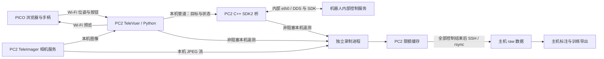
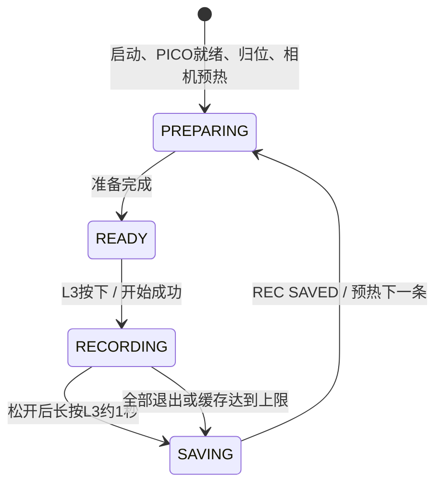

# G1-D PICO 遥操作与实验室数据采集：完整项目说明

核对日期：2026-11-01。

本文按当前本地主机源码和配置核对，覆盖 PC2 直接控制、PICO 操作、L3 分段录制、自动日志、训练数据 v2、主机标注与导出。PC2 实际运行的是同步过去的代码和在 PC2 编译的程序；修改主机文件不会自动更新机器人。

主机项目：`/home/lab209/Proj/Proj_PICO_G1-D`。PC2 项目：`/home/unitree/Proj/Proj_PICO_G1-D`。

日常使用可先看第 3～5 节；维护代码看第 6～8 节；使用采集数据看第 9～13 节。首次配置环境见第 2 节，异常处理见第 14 节。

## 1. 项目做什么，各设备负责什么

本项目面向实验室内的人工遥操作数据采集：用 PICO 4 Ultra 控制 G1-D 的底盘、立柱、腰部、双臂与 Dex3-1 三指手，记录图像、机器人状态、控制目标、操作输入和日志，供后续模型训练使用。

| 设备/组件 | 当前职责 | 地址或位置 |
|---|---|---|
| PICO 4 Ultra | 浏览器显示机器人头部画面；发送头显、两个手柄位姿和按钮/摇杆数据 | 与 PC2 在同一 Wi-Fi |
| 主机 lab209 | 开发、编辑配置、SSH 终端、结束后拉取数据、标注和离线导出 | `/home/lab209/Proj/Proj_PICO_G1-D` |
| PC2 | 运行 TeleVuer、Python 控制、IK、C++ 桥、独立录制与日志进程 | 已使用的无线地址 `192.168.1.118`；内部 eth0 为 `192.168.123.164` |
| 机器人内部控制服务/PC1 | 接收 SDK/DDS 控制请求，提供底盘、关节等反馈 | 通过 PC2 内部 eth0 接入 |
| TeleImager | 已有相机服务，提供头部和两侧腕部图像 | PC2，原有 `tv` 环境 |

上述 IP 是本项目此前使用的地址，不是永久保证。PC2 的 DHCP 地址变化后，SSH、PICO 页面和 HTTPS 证书都要匹配新地址。日常控制不要求登录 PC1。



机器人运动控制不经过主机逐条转发。主机和机器人之间无需外接网线；机器人内部 eth0 仍保留。SSH 用于登录和查看输出，不承载 SDK 运动指令。采集期间没有新增图像上传到主机的线程，但 PICO 输入和预览仍使用 Wi-Fi。

目前实现的是人工示范采集，没有自主语言导航、路径规划、地图定位、任务成功自动识别或模型训练入口。

## 2. 环境、首次准备与更新

### 2.1 已经部署完成时

如果 PC2 已经运行过本项目，不需要每次重建 conda 环境、生成证书或安装 IK。日常直接按第 3 节启动；本次数据 v2 更新涉及 C++，同步后需编译一次。

PC2 运行环境为 `pico_g1d`，默认 Python 路径为：

```text
/home/unitree/miniconda3/envs/pico_g1d/bin/python
```

启动脚本默认使用这个路径，不会单凭当前终端激活了 `tv` 就切换解释器。特殊安装路径可用环境变量 `PICO_G1D_PYTHON=/实际路径/bin/python` 指定。

相机服务继续使用原来的 `tv` 环境。本项目控制与录制使用 `pico_g1d`；不需要把 IK 依赖装进相机服务环境。

### 2.2 尚未准备过 PC2 时

PC2 项目应包含 `deps/unitree_sdk2`、`deps/televuer`、`assets/g1d/g1_d.urdf`、全部 Python/C++ 源码、六份 JSONC 配置，以及 deploy 脚本。SDK2 固定来源见 [SDK2_SOURCE.md](bridge/SDK2_SOURCE.md)，模型来源见 [SOURCE.md](assets/g1d/SOURCE.md)。

依赖源码准备、基础构建工具、项目 HTTPS 证书等细节见 [PC2_DIRECT.md](deploy/PC2_DIRECT.md)；该文部分描述属于早期底盘阶段，当前功能清单以本文为准。依赖已放好后，在 **PC2** 执行一次：

```bash
conda activate tv
cd /home/unitree/Proj/Proj_PICO_G1-D
bash deploy/prepare_pc2_direct.sh 192.168.1.118
bash deploy/prepare_pc2_arms.sh
conda activate pico_g1d
```

第一个脚本从已有相机环境准备项目环境、安装项目使用的 TeleVuer、编译桥并准备证书。第二个脚本向 `pico_g1d` 安装 Pinocchio/CasADi 等 IK 依赖，预热求解器并编译。二者不启动机器人运动控制。

已有证书但 IP 不匹配时，准备脚本会报错，不会自动覆盖证书。证书应按实际 PC2 地址维护。

### 2.3 从主机同步现有项目代码

先正常结束 PC2 的控制/录制程序。下面是已有部署的源码更新命令，在 **主机** 执行；不使用 `--delete`：

```bash
cd /home/lab209/Proj/Proj_PICO_G1-D
rsync -av --relative \
  --exclude='__pycache__/' --exclude='*.pyc' \
  --exclude='bridge/build/' --exclude='bridge/build-arm64/' --exclude='bridge/lib/' \
  g1d_pico/ bridge/ deploy/ README.md PROJECT_GUIDE.md \
  unitree@192.168.1.118:/home/unitree/Proj/Proj_PICO_G1-D/

rsync -av --relative --ignore-existing \
  config/body.jsonc config/arms.jsonc config/recording.jsonc \
  config/logging.jsonc config/dataset.jsonc config/calibration.jsonc \
  unitree@192.168.1.118:/home/unitree/Proj/Proj_PICO_G1-D/
```

第二条只补缺少的配置，不覆盖 PC2 已有调参。若确实要用主机某份配置替换 PC2 文件，单独同步该文件，例如：

```bash
rsync -av --relative config/body.jsonc \
  unitree@192.168.1.118:/home/unitree/Proj/Proj_PICO_G1-D/
```

现有模型未变化时不用重复复制；若代码更新同时改了 URDF，需把实际采用的 `assets/g1d/` 同步过去。不要把主机的 `.local`、日志、缓存、证书私钥和 x86 二进制复制覆盖到 PC2。

涉及 `.cpp` / `.hpp` 时，在 **PC2** 编译：

```bash
conda activate pico_g1d
cd /home/unitree/Proj/Proj_PICO_G1-D
bash deploy/build_on_pc2.sh deps/unitree_sdk2
```

编译结果位于 `bridge/build-arm64/`，配套 DDS 库位于其 `lib/`。只改 Python 或合法配置值不需要 C++ 编译，但需同步并重启。关节 dq/tau_est 记录需要更新后的双臂/手部二进制；旧二进制不会自动产生这些新字段。

## 3. 日常如何启动

### 3.1 登录 PC2

在 **主机终端**执行：

```bash
ssh unitree@192.168.1.118
```

登录后，以下命令运行于 **PC2**：

```bash
conda activate pico_g1d
cd /home/unitree/Proj/Proj_PICO_G1-D
```

保持该 SSH 终端开启。当前启动方式不是后台常驻服务，也不保证关闭 SSH 后仍继续控制。

### 3.2 确认相机服务

相机服务独立于本项目，启动 PICO 程序不会自动启动或修复 TeleImager。已配置为 `teleimager.service` 的 PC2 可查看：

```bash
systemctl status teleimager.service --no-pager
```

如果服务只是停止且配置已经正常，可启动现有服务：

```bash
sudo systemctl start teleimager.service
```

不要在已有服务运行时再手工启动第二个 teleimager-server。录制读取 `127.0.0.1:60000` 获取相机配置，按返回配置订阅各路 JPEG；默认流常用 55555/55556/55557，实际以服务配置为准。

### 3.3 选择一种入口

下列命令均在 **PC2 项目目录**执行，选一种运行，不同时开启多份控制程序。

| 用途 | 命令 | 默认启用内容 |
|---|---|---|
| 相机和底盘 | `bash deploy/run_pc2_base.sh` | 相机、底盘；无立柱/双臂/手部 |
| 相机、底盘和升降 | `bash deploy/run_pc2_base.sh --with-lift` | 在上项基础上启用立柱 |
| 双臂和身体控制 | `bash deploy/run_pc2_arms.sh` | 相机、底盘、立柱、转腰、俯仰、双臂 |
| 完整控制 | `bash deploy/run_pc2_arms.sh --with-hands` | 再加入左右 Dex3-1 |
| 只查看画面/输入 | `bash deploy/run_pc2_base.sh --camera-only` | 不创建机器人运动桥 |
| 控制并采集 | 下方 `record_pc2.sh` | 完整控制可选三指手，并支持 L3 录制 |

**完整控制加数据采集的常用命令：**

```bash
bash deploy/record_pc2.sh \
  --instruction '前往实验台拿起杯子并放到托盘' \
  --scene lab209 \
  --objects 'cup_01,tray_01' \
  -- --with-hands
```

这条命令启动后先准备控制、归位和录制进程，**不会立即开始保存 episode**。普通 `run_pc2_arms.sh` / `run_pc2_base.sh` 不创建 episode，但会保存整场运行日志。

### 3.4 启动选项

| 入口/选项 | 作用 |
|---|---|
| 三个入口的 `--full-log` | 终端显示全部日志；不加则显示必要信息，文件仍接收完整日志流 |
| arms 的 `--with-hands` | 启用左右 Dex3-1，默认不启用手部 |
| arms 的 `--without-lift` | 本次关闭立柱，仍保留腰部和俯仰 |
| arms 的 `--with-lift` | 启用立柱；该入口已经默认开启 |
| arms 的 `--skip-home` | 跳过启动归位；不会禁用运行中的 Y 归位 |
| base 的 `--with-arms` | 底层入口添加双臂和腰部；仍须 `--with-lift` 才有立柱 |
| base 的 `--with-arms-and-hands` | 底层入口添加双臂、腰部和三指手；立柱规则同上 |
| record 的 `--instruction` | 自然语言任务，默认空字符串 |
| record 的 `--scene` | 场景编号，默认 `lab` |
| record 的 `--objects` | 对象信息，原样保存为文本，默认空字符串 |
| record 的 `--` | 左侧是录制信息，右侧传给 arms 入口的功能选项 |
| 各入口的 `--help` | 显示帮助，不启动控制 |

base 的 `--camera-only`、`--with-arms`、`--with-arms-and-hands` 三种模式互斥。录制入口需要详细输出时推荐：

```bash
bash deploy/record_pc2.sh --full-log \
  --instruction '前往实验台拿起杯子' --scene lab209 --objects cup_01 \
  -- --with-hands
```

速度、死区、升降范围等固定从配置文件读取，不接受 `--config`、`--arm-config`、`--body-config` 或旧速度覆盖参数。完整底层选项参考 [RUN_OPTIONS.md](deploy/RUN_OPTIONS.md)。

### 3.5 PICO 连接和启动归位

程序会打印当前 PICO 页面地址。当前无线地址下为：

```text
https://192.168.1.118:8012/?ws=wss://192.168.1.118:8012
```

PICO 浏览器打开该地址，使用已配置的 HTTPS 信任方式，进入页面的 Virtual Reality 模式。PICO、PC2 与主机保持在可互通的同一 Wi-Fi 网络；以终端实际打印的地址为准。

启用双臂且没有 `--skip-home` 时，PICO 数据就绪、两摇杆回中、两侧握松开后，程序倒计时约 3 秒并执行双臂关节归零。**这一启动归位不需要先按 A。** 归位过程中底盘停止、手部不接受操作，B 可取消。

归位针对 14 个手臂关节，不把腰部、立柱或手指归零。它是关节空间平滑轨迹，不是从任意缠绕姿态出发的避碰规划；开始前应让手臂空载并留出运动空间。完成后提示 `HOME_DONE / WAITING_FOR_A`。录制入口还会等待预热完成，显示 `REC READY`。

## 4. PICO 按键与机器人操作

### 4.1 按键表

以下为完整 arms 模式；不启用相应设备的入口不会响应相关功能。

| 控件 | 功能 | 使用方式 |
|---|---|---|
| 右手 A | 接管/恢复遥操作 | 两摇杆回中，双侧握松开；启用手部时先松开两食指扳机；按一次即可 |
| 右手 B | 暂停运动、保持目标；归位时取消归位 | 底盘/升降停止，手臂/腰部/手部进入保持；不结束录制 |
| 左摇杆前后 | 底盘前进/后退 | 偏转越大，目标速度越大；回中为零 |
| 左摇杆左右 | 底盘转向 | 控制 yaw 角速度，不是左右平移 |
| 右摇杆左右 | 上身/腰部左右旋转 | 双臂随躯干转动；回中后减速保持 |
| 右摇杆前后，LIFT 模式 | 立柱升降 | 默认模式；前推升高，后拉降低，受反馈范围限制 |
| 左手 X | 右摇杆纵轴在 LIFT / PITCH 间切换 | 切换后两方向回中解除 `WAIT_CENTER`，再推动纵轴 |
| 右摇杆前后，PITCH 模式 | 上身前后俯仰 | 前推俯身，后拉向配置最小角度恢复 |
| 左手 Y | 请求双臂归零 | 停止身体操作，松侧握、回中后执行；完成后重新按 A |
| 左侧握 + 移动左手柄 | 左臂末端跟随 | 按住跟随，松开保持，可重新握下建立新参考 |
| 右侧握 + 移动右手柄 | 右臂末端跟随 | 同上；不必同时按住两侧 |
| 左食指扳机 | 左三指手开合预设 | 扣下增加闭合，使用过后松开向张开方向运动 |
| 右食指扳机 | 右三指手开合预设 | 同上；侧握与食指扳机功能不同 |
| 左摇杆按压 L3 | 开始/结束本条录制 | `REC READY` 后按一下开始；松开后再次长按约 1 秒结束 |

B 是软件停止/保持，不是断电急停。头显转动不直接命令机器人头部运动；它参与建立手柄控制参考。

A 接管时三指手先保持实际位置，不会因为扳机为零就立即全张开。第一次使用某侧食指扳机后，才进入该侧的开合预设跟随。当前不是独立逐指追踪，也不是力控制。

当前本地俯仰配置为 `0～约 30°`，因此后拉可以从俯身恢复直立，但不能越过最小角度无限后仰。立柱配置使用 `rt/hispeed_state.y` 的反馈坐标，不能把整机 1260～1680 mm 直接填写进去。

### 4.2 哪些情况如何恢复

| 提示/状态 | 含义和下一步 |
|---|---|
| `DISARMED` / `WAITING_FOR_A` | 满足接管条件后重新按 A |
| `NO FRESH PICO DATA` / `WAIT_PICO` | 先恢复 PICO 数据，再回中、松握并按 A；不能靠反复按 A 修复网络 |
| `ARMS FOLLOW=HOLD/HOLD` | 两侧握都松开，所以手臂保持；不是程序退出 |
| `clutch range exceeded` | 单次握持范围超出；松握、回中并按 A，再重新握下 |
| `IK_RETRY` / target rejected | 保留上次目标；将手柄移回可达位置或松握重对齐，后续有效求解可恢复 |
| `HOME_CANCELLED` | 回中并松握后按 A 重试归位；归位完成后再按 A 接管 |
| `RIGHT_Y=... / WAIT_CENTER` | 将右摇杆横纵轴回中后再推动；不要求重新按 A |
| `PITCH_NOT_FOLLOWING` | 当前俯仰请求被局部保持；在 PITCH 模式回中再推动，A 可仍处于使能 |
| `DEX3 ... FEEDBACK_HOLD` | 该侧手部反馈暂停，冻结目标等待恢复；不是原先缺帧即退出逻辑 |
| `WAIT_TRIGGER_RELEASE` | 反馈恢复后，先松开对应食指扳机，再重新操作 |
| `BLOCKED` / `LEAD_LIMIT` | 手指受阻或目标领先量被限制，夹握物体时可出现；不等同于任务成功 |
| `Control fault: ...` 后程序退出 | 读取完整日志查明桥/反馈故障；修复后重新启动，不能只按 A |

手部缺帧不再因为达到 250 ms 就全局退出；PICO 输入、双臂/俯仰反馈等原有保护仍存在。`dataset.jsonc` 的 0.25 秒质量阈值只标记数据，不改变机器人保护或按键状态。

## 5. 一次启动如何采集多条任务

### 5.1 录制状态



| 终端提示 | 是否正在保存新的任务数据 |
|---|---|
| `REC PREPARING` | 否，准备控制/录制，可能等待归位 |
| `REC READY` | 否，等待 L3 |
| `REC STARTING` | 正在创建本条，等待实际开始确认 |
| `REC RECORDING` | 是，持续保存图像、状态、目标和本条日志 |
| `REC STOP_HOLD` | 仍在录制，等待长按达到约 1 秒 |
| `REC STOP_CANCELLED` | 长按不足，继续录制 |
| `REC SAVING` | 已停止新增采集，正在收尾 |
| `REC SAVED` | 本条已完成保存，随后准备下一条 |
| `REC ERROR` / `IN_PROGRESS` | 本条可能未完整保存，按报错或恢复流程处理 |

准备和保存期间的 L3 不排队。开始后必须松开再长按结束；一直按住同一次按键不会立即反向触发停止。L3 不要求摇杆回中，也不会重新启动手臂归位。

### 5.2 推荐的完整操作顺序

1. 在 PC2 启动 `record_pc2.sh ... -- --with-hands`。
2. PICO 连接并进入 VR；摇杆回中、松侧握，完成启动归位。
3. 等待 `REC READY`，按一下 L3，再松开，确认 `REC RECORDING`。
4. 满足接管条件后按 A，完成导航、俯仰/升降、取放等操作。也可以先按 A 再按 L3，二者互相独立。
5. 任务结束后先按 B 停止运动，再长按 L3 约 1 秒，看到 `REC SAVING` 后松开。
6. 等待 `REC SAVED`，重置场景/物体后等下一次 `REC READY`，即可录下一条。
7. 全部任务结束后在 PC2 终端按一次 Ctrl+C，等待 `REC SESSION_END` 和终端提示符返回。
8. 在主机执行 fetch，随后校验、标注和导出。

**A/B 只管运动，L3 只管录制。** B 暂停期间仍然录制；L3 结束本条不自动停止运动。完整启动日志始终另行保存，因此等待、归位、两条任务之间的过程仍可追溯。

一次启动生成一个 `session_id`；每次 L3 开始生成不同的 `episode_id`。同一次启动共用命令中的 instruction/scene/objects 和启动时的配置快照。任务文字变化可重启时改参数，或在主机逐条标注中修正 instruction/task_id/route_id。

### 5.3 退出和缓存上限

当前本地录制配置为：缓存总上限 20 GB，文件系统至少额外保留 2 GB，每路 JPEG 目标上限 20 FPS。额度包含此前未转走的任务及静态快照、状态、日志等；按磁盘块计费，并预留收尾空间。

达到额度或磁盘空间不足时，本条停止新增保存并尝试收尾，控制继续。不会自动上传、自动覆盖旧任务或在空间恢复后悄悄续录。开始时额度已满会拒绝创建本条；先结束整个控制会话，再拉取释放缓存。

Ctrl+C 首次用于正常退出。收尾阶段可能需要刷盘，尤其长任务；继续等待进度。退出收尾时再次 Ctrl+C 会取消保存并保留恢复数据，不能当作“加速正常保存”。

## 6. 程序内部如何运行

### 6.1 Python 与 C++ 分工

| 层次 | 主要作用 | 是否直接执行机器人运动输出 |
|---|---|---|
| Shell 启动脚本 | 选择功能、检查环境/证书/网口/二进制、固定参数路径 | 不负责持续运动计算 |
| Python 输入与控制 | 获取 PICO、A/B/X/Y/L3 状态机、摇杆映射、侧握参考、IK、归位和手部预设 | 通过本机管道提交目标 |
| C++ 桥 | SDK/DDS 通信、读取反馈、检查/限幅目标、持续发布、保持与退出处理 | 是，使用官方接口 |
| 独立录制进程 | 接收本机遥测、订阅 JPEG、配额与文件写入、清单收尾 | 不发送运动指令 |
| 自动日志监督 | 接收输出，分别写文件和筛选终端显示 | 不发送运动指令 |
| 主机离线工具 | 拉取、校验、恢复、标注、对齐导出 | 不启动机器人控制 |

Python 中的 bridge 类是 C++ 子进程的启动/管道封装，不能把它与主机到 PC2 的网络转发混为一谈。当前控制直接在 PC2 上运行；`remote_server.py` 和 RemoteAgvBridge 是旧方案保留代码。

### 6.2 完整采集的主要进程

```text
record_pc2.sh
└── runtime_logging：整场日志监督
    └── recording.runner：录制会话监督
        ├── g1d_pico：主控 Python / TeleVuer / IK
        │   ├── g1d_agv_bridge：底盘与立柱
        │   ├── g1d_arm_bridge：双臂、腰部 yaw、独立 pitch 接口
        │   ├── g1d_hand_bridge left：左 Dex3
        │   └── g1d_hand_bridge right：右 Dex3
        └── episode writer：相机订阅与数据写盘

teleimager.service：机器人原有独立相机服务
```

嵌套启动脚本共用一份运行日志，不会每层各生成一份。每条 episode 的 writer 结束后会预热下一条 writer，主控进程不因此重启或重新归位。

### 6.3 控制计算

- **底盘/立柱**：摇杆经过死区与比例映射，Python 提交目标；C++ 调用 `Move` / `HeightAdjust`，执行输入时效、范围和高度方向限制。
- **双臂**：侧握时捕获手柄与实际末端参考，后续手柄的相对平移/旋转形成躯干坐标下的末端目标；Pinocchio/CasADi/IPOPT 求出 14 个关节解，再进行平滑和关节限速。松握的一侧保持。头显参考在侧握捕获时使用，不持续驱动机器人头部。
- **腰部**：右摇杆横轴驱动 yaw；切到 PITCH 后纵轴驱动俯仰。双臂按“随躯干移动”的方式控制，不固定在世界空间。G1-D pitch 使用独立官方腰部接口，不把 G1 的 lowstate[14] 当作其反馈。
- **手部**：食指扳机生成开合预设，C++ 统一处理速度、目标领先量、受阻保持和释放。拇指展开角保持参考；不是通过手柄姿态逐个推算七个手指关节。

IK 方法参考官方 xr_teleoperate 并适配 G1-D 模型；模型、腰部消息、按键、录制与保护逻辑属于本项目实现。来源和差异见 [NOTICE.md](third_party/unitree_xr/NOTICE.md) 与 [MODEL_COMPARISON.md](third_party/unitree_xr/MODEL_COMPARISON.md)。

当前本地双臂 Python 控制循环设置为 20 Hz，C++ 持续输出与反馈记录各有自己的周期，相机保存为每路最高 20 FPS；三者并非同一个频率。实际运行可能受处理负载影响。

### 6.4 记录与实时控制的关系

Python/C++ 通过非阻塞 Unix 数据报发送小型记录消息，不在控制循环里写数据文件。队列满或接收端不可用时允许丢记录，并尽可能统计序号缺口。录制按钮请求另有本机确认/重发机制；不会因此重发机器人运动命令。

相机直接订阅 PC2 本机现有 JPEG 流，不重新打开 USB 相机。录制与控制分进程，但仍共享 PC2 CPU、内存与磁盘，因此不能保证资源影响为零。主机时间对齐使用磁盘索引，仅在采集结束后的离线导出中运行。

## 7. 项目源码和运行文件组织

```text
Proj_PICO_G1-D/
├── README.md                         常用入口与文档导航
├── PROJECT_GUIDE.md                   本文
├── config/                           六份固定配置，见第 8 节
├── g1d_pico/
│   ├── __main__.py                   控制主循环、使能、归位、资源退出
│   ├── input.py                      带时间戳的 PICO 输入
│   ├── control.py                    底盘/升降/腰部摇杆映射
│   ├── right_stick.py                X 切换与回中解锁
│   ├── arms.py                       双臂会话、侧握跟随、归位协调
│   ├── arm_ik.py / arm_math.py       IK、坐标与侧握参考
│   ├── arm_home.py                   14 关节平滑归零轨迹
│   ├── hands.py                      Dex3 扳机开合与手部状态协调
│   ├── bridge.py                     底盘 C++ 进程封装；也保留旧远程封装
│   ├── arm_bridge.py / hand_bridge.py 上身和手部 C++ 管道封装
│   ├── body_config.py / arm_config.py 配置字段验证
│   ├── config_paths.py / config_io.py 固定路径与 JSONC 解析
│   ├── limits.py / bridge_contract.py 范围常量、Python/C++ 版本核对
│   ├── remote_server.py              旧远程转发方案
│   ├── runtime_logging/              日志监督、文件轮换、队列与终端筛选
│   └── recording/
│       ├── __main__.py               run/verify/recover/fetch/annotate/export 入口
│       ├── runner.py / session.py    启动快照、L3 会话、writer 生命周期
│       ├── button.py                 L3 开始/长按结束与本机通信
│       ├── telemetry.py              Python 非阻塞观测发送
│       ├── recorder.py               相机接收与独立 writer
│       ├── storage.py / layout.py    配额、版本路径、索引、清单、校验
│       ├── dataset.py / views.py     模型/任务/标定快照、整理视图
│       ├── quality.py                有效性和反馈年龄统计
│       ├── shutdown.py               收尾进度与明确取消
│       ├── recovery.py               审计与另存恢复副本
│       ├── transfer.py               单次认证 SSH/rsync、传输锁、校验后删除
│       ├── video.py                  主机 MP4 三路拼接回看
│       ├── annotations.py            主机独立任务标注
│       └── export.py                 主机时间对齐与训练中间格式
├── bridge/
│   ├── CMakeLists.txt / SDK2_SOURCE.md 构建入口和 SDK 来源
│   ├── g1d_agv_bridge.cpp            底盘/立柱接口
│   ├── g1d_arm_bridge.cpp            双臂/腰部接口
│   ├── g1d_hand_bridge.cpp           单侧 Dex3 接口，启动两实例
│   ├── g1d_upper_body_io.hpp         SDK 消息映射与反馈解码
│   ├── g1d_*guard.hpp               输入、关节、腰部/立柱等保护和轨迹逻辑
│   ├── g1d_hand_grasp.hpp            手部受阻、释放与领先量逻辑
│   ├── g1d_recording.hpp             非阻塞遥测、可选数值序列化
│   ├── g1d_dds_channel.hpp           手部 DDS 资源关闭顺序
│   ├── g1d_height_probe.cpp          只读立柱探针
│   ├── g1d_hand_state_probe.cpp      只读手部探针
│   └── build-arm64/                  PC2 编译生成的五个程序及 lib/
├── assets/g1d/                       实际模型、来源和许可证
├── third_party/unitree_xr/           上游参考说明与许可证
├── deploy/                          准备、编译、启动、传输脚本及专题文档
├── tests/                           Python 回归与 C++ 离线测试
├── deps/                            PC2 的 SDK2/TeleVuer 等依赖源码
├── logs/runtime/                    整场运行日志
└── .local/
    ├── https/                       项目 HTTPS 证书与私钥
    ├── sdk2-build-arm64/             SDK 构建
    ├── sdk2-arm64/                   SDK 本地安装
    ├── control_session.lock         控制/传输协调锁
    └── recording_spool/             PC2 录制缓存
```

这是职责结构，`deps/`、`build-arm64/`、`.local/` 等在 PC2 准备或运行后生成，不要求主机也有相同内容。项目目前从源码目录启动；准备脚本中的 `pip install -e` 安装 TeleVuer 依赖，不是把本项目本身安装成包。

## 8. 配置文件怎么改

程序按项目自身位置寻找 JSONC，不依赖终端当前目录；启动时读取，不热更新。JSONC 支持字符串外的 `//` 行注释；不要写不受支持的块注释或末尾逗号。更改后同步到运行端并重新启动。

| 文件 | 内容 | 哪台机器读取 |
|---|---|---|
| `body.jsonc` | 底盘速度/死区、立柱范围/输入比例、腰部 yaw/pitch | PC2 控制程序 |
| `arms.jsonc` | 双臂跟随速度、归位速度、比例、侧握范围、IK 滤波 | PC2 双臂控制 |
| `recording.jsonc` | 缓存目录、总额度、保留空间、图像 FPS、相机列表 | PC2 录制；fetch 的 PC2 端也读取 |
| `logging.jsonc` | 日志目录、最多文件数、刷新与终端提示 | PC2 启动日志监督 |
| `dataset.jsonc` | 采集者/机器人/任务/布局/路线编号、质量阈值、离线对齐参数 | PC2 保存身份快照；主机 export 读取本机导出参数 |
| `calibration.jsonc` | 相机内外参、TCP、立柱映射与定位说明模板 | PC2 录制启动时快照 |

**以下是编写本文时主机文件中的设置，不是硬件极限，也不能证明 PC2 已同步：**

| 配置项 | 当前值 |
|---|---|
| 底盘最大前后目标速度 | 0.30 m/s |
| 底盘最大转向目标速度 | 0.15 rad/s |
| 摇杆死区 | 0.15 |
| 立柱最大归一化输入 | 0.15 |
| 立柱反馈窗口 | 0.00～0.42 m；另有方向停止余量 |
| 转腰角度/速度 | 约 ±30° / 0.10 rad/s |
| 俯仰角度/速度 | 约 0～30° / 0.08 rad/s |
| 双臂关节跟随/归位速度 | 0.25 / 0.15 rad/s |
| 双臂 Python 循环 | 20 Hz |
| 手柄平移比例 | 0.6 |
| 图像保存目标上限 | 每路 20 FPS |
| 缓存上限/磁盘保留 | 20 GB / 2 GB |
| 导出采样/匹配间隔/动作偏移 | 20 Hz / 0.10 s / 0 s |
| 质量报告反馈年龄阈值 | 0.25 s，仅用于标记 |
| 运行日志上限 | 100 份 |

软件允许范围、官方接口范围、模型角度限制和项目建议运行值是不同概念。字段注释与 [OFFICIAL_LIMITS.md](deploy/OFFICIAL_LIMITS.md) 说明了对应来源，本文不把当前运行设置称为官方最大值。

没有真实标定时保持 null，不填虚构的单位阵。填写 calibration.jsonc 只改变归档信息，不自动改变控制坐标，也不会启动定位系统。不要在旧任务尚未传输时更改 recording.jsonc 的 spool，否则 fetch 会查找新位置，旧数据仍留在原处。

## 9. 一条录制的数据格式与文件目录

新录制格式为 `g1d-lab-recording-v2`。旧 v1 的 telemetry.jsonl/frames.jsonl/images 格式仍可校验、恢复、传输和离线导出；不会自动改写旧数据。

### 9.1 单条 episode

```text
episode_YYYYMMDD_HHMMSS_xxxxxxxx/
├── metadata.json                    任务、session、配置、代码摘要、时钟锚点、可用性
├── manifest.json                    正常收尾后生成的清单、统计和校验值
├── observations/
│   ├── images/
│   │   ├── index.jsonl               每帧路径、时间、接收序号、大小、SHA-256
│   │   ├── head/00000000.jpg         头部图像；双目时保留左右拼接
│   │   ├── left_wrist/00000000.jpg
│   │   └── right_wrist/00000000.jpg
│   ├── robot/
│   │   ├── arms.jsonl                双臂 q、腰部状态和反馈时间
│   │   ├── hands.jsonl               每侧手原始 q/目标/状态与各自时间
│   │   ├── body.jsonl                立柱反馈、不可用的底盘定位/实测速度字段
│   │   ├── arm_dynamics.jsonl        双臂和腰部 q/dq/tau_est
│   │   └── hand_dynamics.jsonl       每侧手 q/dq/tau_est、反馈话题
│   └── operator/pico.jsonl           头显/手柄、摇杆、按钮、使能和运行状态
├── actions/
│   ├── arms.jsonl                    双臂请求/输出、前馈力矩和腰部目标
│   ├── hands.jsonl                   手部提交目标、请求和受阻等掩码
│   ├── body.jsonl                    底盘/升降请求、提交值和 SDK 返回码
│   └── bridge_commands.jsonl         Python 给 C++ 的原始协议行
├── robot/
│   ├── model.urdf                    采用的模型内容
│   ├── joint_order.json              数组顺序、SDK 电机索引
│   └── control_config.json           身体/双臂配置快照
├── calibration/calibration.json     标定快照；未提供为 null
├── task/task.json                    原始任务与待审核结果
├── schema/fields.json                字段、单位、坐标系和时间说明
├── quality/summary.json              过期/无效反馈和实际收到的流统计
├── events/control.jsonl              退出等其他控制事件
├── events/console.jsonl              带时间的输出片段
├── logs/console.log                  本条录制期间可读日志
└── IN_PROGRESS                      仅录制中或未完成时存在；正常收尾移除
```

图像是 TeleImager 传来的 JPEG 字节，录制时不重新编码 MP4。JSON 保存静态对象，JSONL 每行一个独立事件，UTF-8 编码。只有收到某路数据才创建该 JSONL，缺文件不等于该设备测量全为零。

同一次启动的多个任务独立存储，不拼接为一个大文件：

```text
recording_spool/
├── episode_..._aaaaaaaa/    第一条任务
├── episode_..._bbbbbbbb/    第二条任务
└── episode_..._cccccccc/    第三条任务
```

### 9.2 关节、动作和单位

| 数据 | 含义 |
|---|---|
| 双臂 q[14] | 实测关节角，左 7 后右 7，rad，对应 lowstate motor[15..28] |
| 每侧手 q[7] | HandState motor[0..6] 的实测角，rad |
| dq | SDK MotorState 的速度反馈，rad/s |
| tau_est | SDK 的估计力矩，N·m；不是实测接触力/触觉 |
| requested_q | 操作意图/请求目标 |
| output_q / sent_q | 桥限速、受阻处理后提交的目标；提交成功不代表物理到位 |
| output_tau_ff | 命令前馈力矩，不能用作实测力矩 |
| height_m | 立柱原始反馈坐标，m |
| body requested/submitted | 顺序为 vx、yaw、lift；m/s、rad/s、归一化输入 |
| PICO 4×4 位姿 | XR 跟踪空间数据，不是机器人地图坐标 |

每臂依次为肩 pitch、肩 roll、肩 yaw、肘、腕 roll、腕 pitch、腕 yaw。每侧三指手依次为拇指 0/1/2、中指 0/1、食指 0/1；以实际存储的关节顺序说明和 SDK 索引为准。

非有限的可选 dq/tau_est 保存为 null。SDK 给出有限数值不代表已经独立验证了传感精度。手部状态与动作分别保留，所以夹持物体时“目标闭合量大于实测关节位置”可以被正常记录，不会伪造到位状态。

### 9.3 时间、质量与派生文件

原始事件外层包含以下字段；具体载荷按 stream 类型解释：

| 字段 | 含义 |
|---|---|
| `stream` | 事件类型 |
| `producer` / `seq` | 发送进程身份与其自己的序号，不是全局帧号 |
| `emitted_monotonic_s` | PC2 发送进程单调时间，秒 |
| `recorder_received_monotonic_s` | PC2 录制进程接收时间，秒 |
| `data` | 源状态、指令或事件载荷 |
| `quality` | 源反馈年龄、数值有效性；不是机器人控制指令 |

关节 `received_at` 是原始 DDS 反馈在 PC2 收到的时间，重复快照保留旧时间。图像 `received_monotonic_s` 是 ZMQ 收到 JPEG 的时间，不是曝光时间；没有硬件曝光时间和源帧号时明确为 null。不同流的第 N 行没有天然对应关系。

`observations/robot/body.jsonl`、`actions/hands.jsonl` 是 writer 整理出的视图，带 `derived_from` 指向原始事件。这些不是又接收到一包机器人反馈，不能与源事件重复计数。

`metadata.json` 还保存单调时间与 Unix 时间锚点、源文件/二进制摘要。摘要用于识别版本，不等于保存了全部源码和环境；长期复现仍需保留对应源码版本及依赖。

### 9.4 尚未采集的内容

当前没有底盘在实验室地图中的全局定位轨迹、实测底盘平面速度、独立深度图、相机曝光时间、触觉或标定后的抓取 TCP。没有将速度指令积分冒充真实轨迹。URDF 归档不含可视化 mesh；立柱两段伸缩映射与工具中心仍需实测标定。

因此，“机器人状态已保存”主要指关节、腰部和立柱等反馈，不能解释为完整的世界坐标轨迹。`task_success` 默认未知；程序正常退出或 L3 保存完成不表示任务成功。

## 10. 两类日志有什么区别

| 项目 | 整场运行日志 | 单条任务日志 |
|---|---|---|
| 位置 | PC2 `logs/runtime/run_日期_时间_微秒_编号.log` | episode 内 `logs/console.log` 与 `events/console.jsonl` |
| 范围 | 启动、等待、归位、所有 episode、退出收尾 | 该条实际录制区间 |
| 不按 L3 是否存在 | 存在 | 不创建 episode |
| 上限 | 默认最多 100 份；新建时淘汰最旧已关闭文件 | 随 episode 计入缓存配额 |
| fetch 是否传回 | 不会自动传回 | 随 episode 一起传回 |
| `--full-log` 影响 | 只影响终端显示 | 不改变记录内容 |

日志使用有界队列。终端慢不会让控制循环等写盘；极端积压可能丢日志，并报告丢失信息，因此“完整日志流”不应理解为任何负载下绝对零丢失。

查看最近运行日志，在 **PC2** 执行：

```bash
cd /home/unitree/Proj/Proj_PICO_G1-D
ls -lt logs/runtime/ | head -n 6
```

需要长期保存整场日志时，控制结束后在 **主机** 另行复制：

```bash
mkdir -p /home/lab209/Datasets/G1D_Lab/run_logs
rsync -av \
  unitree@192.168.1.118:/home/unitree/Proj/Proj_PICO_G1-D/logs/runtime/ \
  /home/lab209/Datasets/G1D_Lab/run_logs/
```

主机这份归档不受 PC2 的 100 份自动轮换管理。TeleImager 的服务日志属于另一套日志，可用 journalctl 查看。

## 11. 结束后如何传回主机

推荐主机目录：

```text
/home/lab209/Datasets/G1D_Lab/
├── raw/episode_.../                   原始完整数据，保持不修改
├── videos/episode_.../overview.mp4     可选 MP4 回看；另有 video.json
├── annotations/episode_.../labels.json 人工标注
├── training/episode_.../              离线对齐结果
└── run_logs/                         可选的整场日志归档
```

之前已保存在 `G1D_Lab/episode_...` 的任务无需搬动；工具也接受旧路径。从新任务开始统一保存到 raw 即可。

确认 PC2 控制已经退出且终端返回后，在 **主机** 执行：

```bash
conda activate pico_g1d
cd /home/lab209/Proj/Proj_PICO_G1-D
bash deploy/fetch_pc2_recordings.sh \
  --host unitree@192.168.1.118 \
  --destination /home/lab209/Datasets/G1D_Lab/raw \
  --delete-after-verify
```

程序通过 SSH/rsync 拉取完整 episode，逐文件校验并刷盘，再核对 PC2 源数据；只有符合条件时才按 `--delete-after-verify` 删除已验证的 PC2 源任务。去掉此选项则保留源副本。IN_PROGRESS 不自动拉取或删除；传输失败保留源文件和主机临时数据。

fetch 现在共用一次 SSH 认证，整批任务不再逐条询问密码。连接中断时保留未完成数据，重新运行 fetch 即可。加 `--with-video` 可在拉取结束、关闭 SSH 后由主机生成三路拼接 MP4，默认输出至 destination 上一级的 `videos/`。该选项加在主机 fetch 命令中，不加到 PC2 录制命令。

fetch 与当前项目的控制会话互斥，因此即使本条 REC SAVED，也要结束整个控制程序后再拉取。该锁不控制其他项目或外部上传工具。

### 11.1 单独生成已有数据的视频

```bash
conda activate pico_g1d
cd /home/lab209/Proj/Proj_PICO_G1-D
bash deploy/make_recording_video.sh \
  /home/lab209/Datasets/G1D_Lab/raw/episode_* \
  --output-root /home/lab209/Datasets/G1D_Lab/videos
```

每条生成 `videos/<episode_id>/overview.mp4` 和 `video.json`，不修改原始 episode。默认头部在上、双腕在下，20 FPS，按接收时间戳保持任务时长；断流超过 0.25 秒显示黑底 GAP。视频仅用于回看，不替代原始训练数据。视频失败不会删除主机 raw，可独立重试；PC2 源数据仍按原始数据校验结果决定是否删除。独立选项、依赖和复用规则见 [HOST_VIDEO.md](deploy/HOST_VIDEO.md)。

## 12. 主机校验、标注和训练导出

### 12.1 校验原始数据

在 **主机** 项目目录中，把下面的 episode 名替换成真实名称：

```bash
conda activate pico_g1d
cd /home/lab209/Proj/Proj_PICO_G1-D
episode=/home/lab209/Datasets/G1D_Lab/raw/episode_YYYYMMDD_HHMMSS_xxxxxxxx
python -m g1d_pico.recording verify "$episode"
```

verify 检查文件完整性、清单、图像索引与哈希；还应查看图像和任务质量。重点看 manifest 的结束原因、各路帧数/流计数/缺口，以及 quality/summary.json 的过期/非有限统计。

`joint_dynamics_received` 表示对应动态流是否收到过；不能只凭 hand_dynamics 为 true 就认为两侧手都完整，还需检查 side 和有效性。

### 12.2 创建并编辑标注

```bash
python -m g1d_pico.recording annotate "$episode" \
  --output-root /home/lab209/Datasets/G1D_Lab/annotations
```

生成独立的 `annotations/<episode_id>/labels.json`，不覆盖已有文件。编辑内容：

| 字段 | 填写方式 |
|---|---|
| `review_status` | unreviewed / accepted / rejected |
| `task_success` | true / false / null |
| `navigation_success` / `grasp_success` / `placement_success` | 分阶段结果，true / false / null |
| `instruction` / `task_id` / `route_id` | 该条实际任务与编号 |
| `object_ids` | 对象编号字符串数组，例如 `["cup_01", "tray_01"]` |
| `stages` | 有序、无重叠的阶段区间 |
| `interventions` / `exclude_intervals` | 人工干预或需要排除的区间 |
| `notes` | 失败原因与补充说明 |

区间统一使用 `start_s`、`end_s`、`label`，以本条录制起点为 0 秒，左闭右开，不能超过 duration_s。例如：`{"start_s": 0, "end_s": 8.5, "label": "navigate"}`。

不要改动自动生成的 episode_id、schema、duration_s、time_origin、source_manifest_sha256，它们把标注绑定到特定原始记录。不要编辑 raw/episode/task/task.json，也不要往原始 episode 添加文件，否则原始哈希校验会失效。

### 12.3 导出时间对齐后的训练数据

```bash
python -m g1d_pico.recording export "$episode" \
  --annotations "/home/lab209/Datasets/G1D_Lab/annotations/${episode##*/}/labels.json" \
  --output-root /home/lab209/Datasets/G1D_Lab/training
```

导出使用**主机**固定的 dataset.jsonc。省略 --annotations 可以先看质量，但任务结果仍为未知。已有输出目录不覆盖；改标注后可改用 training_v2 等新目录重导。

```text
training/episode_.../
├── data/samples.jsonl      每行一个对齐时间步
├── data/images.jsonl       使用到的图像索引与哈希
├── images/{camera}/       图像副本，独立于原始目录可搬移
├── source/                原 metadata、模型、控制配置、标定与字段说明
├── labels.json            本次标注快照
├── schema.json            导出配置、单位、匹配规则和原 manifest 摘要
├── quality.json           样本数、有效样本数、无效通道计数
├── manifest.json          导出完成清单
└── IN_PROGRESS            仅导出未完成时存在
```

每个样本包含 step_index、timestamp_s、PC2 单调时间、observation、action、instruction、阶段/排除信息，以及 eligible_for_imitation 和不满足原因。每个通道有 valid、source_monotonic_s、time_delta_s，存在数据时还有 available_monotonic_s；缺失通道 data=null，dq/tau_est 另有字段有效性。

- 观测取 t 时刻之前且当时已到达 recorder 的最近值，限制最大时间差。
- 动作取 t + offset 时刻及之后最近一次提交的目标，也限制最大时间差。
- 不用未来状态充当当前观测，不把实测 q 当成动作，不插值补造测量，不把缺失数据填成零。
- 图像按接收时间对齐，仍不是硬件同步；相邻时间步允许在时间差阈值内引用同一张源图。

只有人工 accepted、task_success=true、必须通道有效、操作者使能且不在归位、未处于标注排除/干预区间，才可能成为 eligible_for_imitation=true。dq/tau_est 为可选动态字段，是否用于具体模型还要检查其字段掩码；当前导出不会仅因可选力矩缺失而否定所有样本。恢复任务不自动成为成功示范，失败和无效样本仍保留用于分析。

输出是项目定义的训练中间格式，不是已兼容任意模型的 LeRobot/RLDS 文件。后续需要按模型做特征维度、归一化、动作时域和数据划分适配。应按 session/layout/route 等分组划分训练验证集，不把同一轨迹相邻帧随机分到两边。

导出使用主机磁盘临时索引控制内存增长，会复制使用到的 JPEG，因此主机要预留额外空间。raw 保持不变，导出可以重建。

## 13. 未完成任务如何处理

如果出现 IN_PROGRESS 或“未完成任务保留在 PC2”，不要手动删除标记或把目录当作成功任务。先结束控制，在主机备份该原始目录，再运行 recover。

以下名称需要替换为实际未完成任务：

```bash
mkdir -p /home/lab209/Datasets/G1D_Lab_recovery_original
rsync -av --partial \
  unitree@192.168.1.118:/home/unitree/Proj/Proj_PICO_G1-D/.local/recording_spool/episode_YYYYMMDD_HHMMSS_xxxxxxxx \
  /home/lab209/Datasets/G1D_Lab_recovery_original/

cd /home/lab209/Proj/Proj_PICO_G1-D
unfinished=/home/lab209/Datasets/G1D_Lab_recovery_original/episode_YYYYMMDD_HHMMSS_xxxxxxxx
python -m g1d_pico.recording recover "$unfinished"
```

先看审计结果。允许恢复后，输出到原备份目录**之外**：

```bash
python -m g1d_pico.recording recover "$unfinished" \
  --output-root /home/lab209/Datasets/G1D_Lab_recovered
```

它创建新的 episode，保留源文件、原时间与模型/标定快照。只有末尾一行 JSONL 残缺且确认可舍弃时，才使用 `--allow-truncated`；中间损坏或索引图像校验错误仍拒绝恢复。

恢复副本明确标记尾部完整性未知，不自动删除原缓存，也不自动判定成功。v2 分流文件不能还原总接收顺序，恢复时跨文件缺包计数不重建；空计数不是“没有丢包”的结论。详细规则见 [PC2_RECORDING_RECOVERY.md](deploy/PC2_RECORDING_RECOVERY.md)。

## 14. 常见问题与诊断入口

| 现象 | 优先检查 |
|---|---|
| PICO 8012 页面无法访问 | PC2 无线 IP、同网互通、程序仍运行、证书匹配；以启动打印 URL 为准 |
| 8012 被占用 | PC2 执行 `ss -ltnp 'sport = :8012'`，识别旧实例并正常退出 |
| 能看到页面但没有机器人图像 | TeleImager 服务及 60000 配置接口、头部 ZMQ；PICO 能连接不代表相机服务出帧 |
| 启动缺少配置文件 | 同步全部所需 JSONC，尤其新增 dataset/calibration；不要仅把旧 JSON 改名 |
| 修改配置没有生效 | 确认改的是 PC2 文件且程序已重启；功能开关也可能关闭该能力 |
| 左摇杆无反应 | 是否 ARMED、是否在归位、是否运行 camera-only、PICO 是否新鲜；查看本场完整日志 |
| 右纵轴无反应 | LIFT/PITCH、WAIT_CENTER、立柱是否启用、角度/高度限制与反馈状态 |
| 只有手部不动 | 是否带 --with-hands、A 前扳机是否松开、是否等待新反馈/扳机释放；查看两侧状态 |
| L3 再按没结束 | 需先松开，再长按约 1 秒；短按取消结束；准备/保存期间不排队 |
| 没有新的 episode | 普通运行入口不录制；record 入口也需 REC READY 后按 L3 |
| fetch 被拒绝 | 完整控制会话是否已退出；REC SAVED 不等于主控已退出 |
| dq/tau_est 文件缺失 | PC2 是否重编译更新桥、是否启用对应设备、该流是否到达 recorder |
| eligible_samples=0 | 人工标注是否 accepted 且成功、数据新鲜度/缺流、使能/归位、排除区间和恢复标记 |
| verify 报 unexpected files | 是否往原始 episode 添加了标注/临时文件；标注应在 annotations 中 |

相机服务日志可在 PC2 查看：

```bash
journalctl -u teleimager.service -n 100 --no-pager
```

保留问题发生的完整 runtime 日志和对应 episode 的 metadata/manifest/quality。默认终端隐藏周期数值不意味着文件里没有它们，也不意味着控制停止。优先依据时间、状态和错误原因定位，避免只按 A 反复尝试。

## 15. 相关资料与验证边界

| 内容 | 文档 |
|---|---|
| 简短入口 | [README.md](README.md) |
| 启动选项与固定配置 | [RUN_OPTIONS.md](deploy/RUN_OPTIONS.md) |
| 初始环境和连接准备 | [PC2_DIRECT.md](deploy/PC2_DIRECT.md)、[PC2_ARMS.md](deploy/PC2_ARMS.md) |
| 身体与手臂调参 | [BODY_CONFIG.md](deploy/BODY_CONFIG.md)、[ARM_TUNING.md](deploy/ARM_TUNING.md) |
| 转腰、俯仰、升降 | [PC2_TORSO_LIFT.md](deploy/PC2_TORSO_LIFT.md) |
| Dex3 控制 | [PC2_HANDS.md](deploy/PC2_HANDS.md) |
| 参数范围来源 | [OFFICIAL_LIMITS.md](deploy/OFFICIAL_LIMITS.md) |
| 自动运行日志 | [RUNTIME_LOGGING.md](deploy/RUNTIME_LOGGING.md) |
| 录制和缓存 | [PC2_RECORDING.md](deploy/PC2_RECORDING.md) |
| 主机单次认证传输与视频回看 | [HOST_VIDEO.md](deploy/HOST_VIDEO.md) |
| 训练数据 v2 | [TRAINING_DATA.md](deploy/TRAINING_DATA.md) |
| 恢复流程 | [PC2_RECORDING_RECOVERY.md](deploy/PC2_RECORDING_RECOVERY.md) |

部分专题文档保留阶段性升级记录；日常操作以本文与当前入口脚本为准。本次仅更新说明文档，并核对源码、命令语法和文档链接，没有连接或操作机器人。PC2 的实时性能、传感器精度与实际任务质量仍须依据真机运行数据判断。
