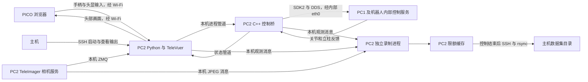

# G1-D PICO 遥操作与数据采集项目说明

本文对应 2026 年 10 月 30 日的项目代码。平台为 PICO 4 Ultra、宇树 G1-D 旗舰版和左右 Dex3-1 三指灵巧手；用途是在实验室中进行人工遥操作，并保存导航、操作及抓取过程的数据。

当前部署把运行程序放在机器人 PC2 上：Python 读取 PICO 输入、生成控制目标，C++ 调用宇树 SDK2 与机器人内部控制接口通信。采集数据先写入 PC2 的限额缓存，任务结束后再传到主机长期保存。主机主要承担开发、远程终端和数据管理。

这套工程已经包含底盘、立柱、腰部转动、上身俯仰、双臂、三指手、相机显示、录制和数据传输。导航任务由人通过 PICO 执行，项目本身没有语言导航策略或自主规划器。

## 设备分工与网络

| 设备 | 本项目中的职责 | 常用位置或地址 |
|---|---|---|
| PICO | 浏览器运行 XR 页面，显示机器人头部画面，上传头显和手柄输入 | 访问 PC2 的 Wi-Fi 地址，端口 8012 |
| PC2 | 运行 TeleVuer、Python 控制程序、IK、C++ 桥和录制程序；已有 TeleImager 服务提供相机数据 | `/home/unitree/Proj/Proj_PICO_G1-D`；已使用的 Wi-Fi 地址为 `192.168.1.118` |
| PC1 及内部控制器 | 接收相应机器人控制接口的指令，执行底层控制并产生状态反馈 | 经 PC2 内部 `eth0` 访问；PC2 已使用的地址为 `192.168.123.164` |
| lab209 主机 | 修改代码、同步到 PC2、SSH 查看运行输出、拉取和分析数据 | `/home/lab209/Proj/Proj_PICO_G1-D`；数据通常放 `/home/lab209/Datasets/G1D_Lab` |

Wi-Fi 地址可能变化，应以 PC2 当前 `wlan0` 地址为准。Python 启动器会读取该地址并检查 HTTPS 证书是否覆盖它。



没有 Mermaid 渲染器时，可以按三条路径理解：

- 控制：`PICO → Wi-Fi → PC2 Python → 本机 C++ 桥 → 内部 eth0 → 机器人`。
- 预览：`机器人相机 → PC2 TeleImager → Python / TeleVuer → Wi-Fi → PICO`。
- 保存：`PC2 相机及控制观测 → PC2 磁盘缓存 → 任务结束后传到主机`。

现在的 PC2 执行控制程序，不需要主机把每条运动指令转发到 PC2。主机与机器人之间也不需要外接网线。不过 PICO 输入与预览仍使用 Wi-Fi；“结束后上传”减少的是录制文件传输流量，并不表示操作期间完全不使用无线网络。

主机不在逐帧控制数据通路中，但当前程序通常在 SSH 前台启动，仍应保持终端打开。项目没有自动配置脱离终端运行的控制服务，也不需要另行 SSH 登录 PC1 才能执行当前控制程序。

## Python 与 C++ 如何分工

| 层次 | 主要代码 | 负责什么 |
|---|---|---|
| Python 输入与会话层 | `input.py`、`__main__.py`、`right_stick.py` | 接收 PICO 数据；判断按键、数据新鲜度、接管和归位状态；协调各模块 |
| Python 目标生成层 | `control.py`、`arms.py`、`arm_math.py`、`arm_ik.py`、`hands.py` | 摇杆映射、手柄相对位姿转换、双臂 IK、扳机到手指目标的映射 |
| Python 进程通信层 | `bridge.py`、`arm_bridge.py`、`hand_bridge.py` | 创建 C++ 子进程，通过管道发送目标并读取状态；不直接驱动电机 |
| C++ 执行层 | `bridge/` 下的控制桥和保护模块 | 连接 SDK2 / DDS，读取机器人反馈，检查和限速目标，构造并发布机器人指令 |
| Python 数据层 | `g1d_pico/recording/` | 缓存、索引、日志、校验、收尾、恢复和结束后的传输 |

Python 适合组织流程、配置和数值计算。Pinocchio 处理机器人模型与运动学，CasADi / IPOPT 完成优化求解；这些库底层包含原生代码，因此 IK 并不是用 Python 循环逐个尝试关节角。

C++ 进程集中处理 SDK2、消息构造和持续指令输出。进程分离使 Python 的图像处理或 IK 抖动不会直接变成 C++ 发布循环中的同一次阻塞；与此同时，C++ 保留输入过期检查，不能靠重复旧目标掩盖 PICO 失联。它们都是普通 Linux 用户态进程，实际周期受调度和负载影响，不能视为硬实时控制器。

本项目直接使用 SDK2 的 DDS 通道和客户端接口。虽然话题名形如 `rt/lowstate`，主程序没有组织成 ROS 2 node / launch 工程，部署也不要求先启动一套 ROS 2 节点图。

## 进程和程序入口

仅运行完整控制时，主要关系如下：

```text
run_pc2_arms.sh
└── run_pc2_base.sh
    └── python -m g1d_pico
        ├── TeleVuer 的 XR 服务子进程
        ├── g1d_agv_bridge          底盘与立柱
        ├── g1d_arm_bridge          双臂、腰部 yaw、上身 pitch
        ├── g1d_hand_bridge left    可选，左 Dex3
        └── g1d_hand_bridge right   可选，右 Dex3

teleimager-server                   PC2 已有的独立相机服务
```

启动录制时，外面增加一层监督程序：

```text
record_pc2.sh
└── python -m g1d_pico.recording run
    ├── recorder 子进程（按条启动）  接收图像与状态、写 PC2 缓存
    └── run_pc2_arms.sh             上述完整控制进程树
```

监督程序还用线程持续读取控制进程的终端输出，分别送往日志和终端显示。TeleImager 不由这个进程树启动；相机服务是否正常，需要单独管理。

| 入口 | 默认功能 |
|---|---|
| `bash deploy/run_pc2_base.sh` | 相机预览与真机底盘；默认不启用立柱 |
| `bash deploy/run_pc2_base.sh --with-lift` | 相机、底盘与立柱 |
| `bash deploy/run_pc2_base.sh --camera-only` | 预览和 PICO 输入；不创建机器人运动桥 |
| `bash deploy/run_pc2_arms.sh` | 相机、底盘、立柱、双臂、腰部 yaw / pitch |
| `bash deploy/run_pc2_arms.sh --with-hands` | 上述功能加左右 Dex3 |
| `bash deploy/record_pc2.sh -- --with-hands` | 完整控制加本地录制 |
| `bash deploy/fetch_pc2_recordings.sh ...` | 在主机执行，拉取已完成数据 |

这些 `run_pc2_*` 脚本是 PC2 的真机启动入口，会自动补齐 `--live`、`eth0`、ARM64 二进制、证书和本机相机地址。直接执行 `python -m g1d_pico` 则默认干运行，并且保留了早期主机部署的默认网卡和二进制路径；两者不能不加区别地互换。

当前运行节奏如下，均为目标或近似值：

| 环节 | 节奏及含义 |
|---|---|
| Python 主循环 | 双臂启用时取 `arms.jsonc` 的 `control_hz`，当前 20 Hz；纯底盘模式 20 Hz |
| 底盘桥 SDK 调用 | 发送间隔至少约 50 ms，目标约 20 Hz |
| 上身桥 | 每轮休眠 5 ms，名义约 200 Hz；实际包含本轮处理时间 |
| 每侧手部桥 | 每轮休眠 10 ms，名义约 100 Hz，不追赶式突发补发 |
| 上身和手部回传给 Python 的状态 | 约每 20 ms 报告一次；原始反馈时间戳仍保留 |
| PICO 预览 | TeleVuer 请求显示 30 FPS，受主循环及图像链路影响 |
| 图像保存 | 当前每路目标 20 FPS，独立于关节指令频率 |

## 一次操作怎样变成机器人动作

### 输入和全局状态

`FreshTeleVuer` 在手柄事件到达时，更新共享内存里的摇杆、按键、位姿和接收时间。Python 主循环读取这些快照，避免把“曾经连接过”当作“现在仍有新数据”。

默认启动双臂模式后，程序等待 PICO 就绪、摇杆回中和侧握松开，再倒计时 3 秒执行双臂归位。归位目标是 14 个手臂关节的零位，使用平滑轨迹并等待反馈稳定；它不复位底盘、立柱、腰部或手指，也不是厂家提供的避碰回收动作。

归位完成后按右 A，进入接管状态。A 是按下沿触发，无需一直按住。右 B 解除全局运动使能；手臂和手部的 HOLD 表示停止继续跟随目标，不代表切断电机电源。

| 输入 | 当前完整控制模式下的行为 |
|---|---|
| 左摇杆前后 | 底盘前进和后退 |
| 左摇杆左右 | 底盘转向；G1-D 当前接口不支持侧移 |
| 右摇杆左右 | 腰部左右转动，双臂随躯干转动 |
| 右摇杆前后 | 默认控制立柱；切到 PITCH 后控制上身俯仰 |
| 左 X | 切换 LIFT / PITCH；切换后右摇杆回中，再推动才执行新的纵轴功能 |
| 左右侧握键 | 按住后，对应手臂跟随该手柄的相对运动；松开则保持 |
| 左右食指扳机 | 对应 Dex3 的开合意图，需加 `--with-hands` |
| 右 A | 满足回中、侧握松开等条件后接管；手部初次接管还要求扳机松开 |
| 右 B | 停底盘和升降，保持双臂、腰部与手部；可取消归位 |
| 左摇杆按压 L3 | 在录制入口中回中长按约 1 秒，开始/结束一条录制；每次需松开，保存中不接受下一条 |
| 左 Y | 请求双臂重新归位，期间底盘停止；完成后按 A 恢复遥操作 |

### 底盘与立柱

`control.py` 对摇杆应用死区，然后按剩余行程重新缩放。左摇杆产生 `vx` 和 `yaw`，右纵轴在 LIFT 模式产生归一化升降值。摇杆打满时才达到配置的最大幅值。

`bridge.py` 把一行 `vx vyaw vz` 写入底盘 C++ 进程的标准输入。`g1d_agv_bridge.cpp` 校验数值后，通过官方 `AgvClient::Move(vx, 0, vyaw)` 和 `HeightAdjust(vz)` 调用机器人接口；`rt/hispeed_state.y` 提供立柱位置反馈。

立柱会受反馈新鲜度、配置高度窗口和两端余量限制。高度是该接口的反馈坐标，不是机器人顶部离地高度。底盘目前记录请求速度和 SDK 返回码，没有取得实验室坐标系中的底盘位置反馈。

### 双臂与逆运动学

手柄提供的是六自由度位姿：三个位置分量和三个朝向分量。程序据此给出末端目标，再求解每条手臂的七个关节角；它不需要测出操作者的每个肘关节角。

从一次侧握开始，控制过程为：

1. 捕获手柄当前位姿、机器人当前实测腕部操作坐标系，以及头显的水平朝向。
2. 将之后手柄的相对位移和旋转转换到机器人坐标方向。XR 的“右、上、后”转换为机器人的“前、左、上”；该次侧握期间的对齐方向保持不变。
3. 位移按 `position_scale` 缩放，叠加到捕获时的机器人末端位置；手柄旋转增量叠加到末端朝向。
4. 在 IK 前限制末端目标变化速率，再由 Pinocchio / CasADi / IPOPT 优化 14 个关节变量。未按侧握的一侧锁在上次目标，不会被另一侧求解带动。
5. 对求解结果滤波、按左右臂分别限速，再根据实测手臂和腰部角度计算模型重力前馈。
6. C++ 接收目标，检查关节限位和输入时效，生成最终关节指令并发布。

`arm_ik.py` 参考宇树 `xr_teleoperate` 的 G1 IK 目标函数、滤波和重力补偿，使用本项目中的 G1-D URDF；这是适配后的实现，不是原封不动运行官方完整遥操作程序。来源和改动见 [第三方说明](third_party/unitree_xr/NOTICE.md)。

末端操作坐标系使用腕部局部 X 方向 5 cm 的偏移，尚未标定成实际 Dex3 抓取 TCP。IK 采用躯干相对目标，因此腰部转动或俯仰时双臂随躯干移动；当前没有让手始终固定在实验室世界坐标中的功能。

### 腰部和俯仰接口

腰部与双臂共用上身桥，但使用的机器人接口不同：

| 控制对象 | 指令接口 | 反馈接口 |
|---|---|---|
| 双臂 | `rt/lowcmd` 的关节槽 15～28 | `rt/lowstate` 的对应关节 |
| 腰部 yaw | `rt/lowcmd` 的槽 12 | `rt/lowstate` 的槽 12 |
| 上身 pitch | 独立的 `rt/waistpitchcmd` | 独立的 `rt/waistpitchstate` |
| 立柱 | SDK2 `HeightAdjust` | `rt/hispeed_state.y` |

G1-D URDF 的 `torso_Joint` 是 yaw，名称为 `Yaw_Joint` 的关节实际上绕 Y 轴俯仰。当前程序不使用 `lowstate[14]` 冒充俯仰反馈。`g1d_upper_body_io.hpp` 集中处理这些消息映射。

### Dex3 三指手

每侧 Dex3 有独立 C++ 进程。Python 将食指扳机的 0～1 值映射为七个关节的开合目标；拇指展开角沿用捕获值，其余关节使用预设弯曲姿态。三指手采用该预设协同开合，并非逐指动作追踪。

C++ 订阅该手的常规和低频状态，选择较新的有效反馈，再统一执行关节限位、速度限制、目标领先量限制和抓握受阻处理。抓住物体后，“目标角度与实测角度不同”可能是接触造成的正常现象；`BLOCKED` 用于保持捕获的参考，松扳机则进入张开处理。

这种抓握是带约束的位置控制，不是夹持力闭环；`BLOCKED` 也不是抓取成功标签。相关参数目前仍在 `g1d_hand_grasp.hpp` 等源码中，没有独立的手部 JSONC 文件。详见 [手部控制说明](deploy/PC2_HANDS.md)。

## Python 与 C++ 的通信边界

同一台 PC2 上的 Python / C++ 主要通过标准输入输出管道通信，不经 Wi-Fi：

| 通道 | Python 发给 C++ | C++ 回到 Python |
|---|---|---|
| 底盘桥 | 三个数：`vx vyaw vz` | 终端诊断；录制时另发本机观测消息 |
| 上身桥 | `ARM`、`HOLD`、`PITCH_HOLD`、`TARGET6` 等 | `STATE6`：双臂、腰部、各自反馈时间和状态 |
| 手部桥 | `ARM`、`KEEPALIVE`、`TARGET`、`HOLD`、`RELEASE` | `HANDSTATE2`：实测、请求、最后发布目标、时间和抓握标记 |

输入携带 PC2 的单调时钟时间。重复打印状态或发送命令不会把旧反馈刷新成新反馈；DDS 写入时间和反馈接收时间分开记录。SDK 调用成功或 DDS Write 成功，只能说明相应软件提交成功，不能证明关节已经到位。

桥进程的 `stderr` 用于诊断；上身和手部的 `stdout` 同时承载状态协议，修改时应保留协议格式。Python 专门的读取线程负责解析，不让主循环逐行等待反馈。

`bridge_contract.py` 会在启动 AGV / 上身桥前查询二进制中的范围版本。代码更新后若仍用旧二进制，会明确提示重新编译。手部也通过 `HANDSTATE2` 检查协议版本；不能只更新 Python 而忽略对应 C++ 修改。

## 目录结构和文件职责

以下区分源代码目录与运行时目录。主机当前没有某些 PC2 依赖或缓存目录是正常的，不需要为了目录看起来一致而复制机器人缓存。

```text
Proj_PICO_G1-D/
├── README.md                    当前项目入口和常用命令
├── PROJECT_GUIDE.md             本说明
├── g1d_pico/                    Python 控制与采集包
│   ├── __main__.py              主循环、启停、模块协调
│   ├── input.py                 PICO 输入快照和接收时间
│   ├── control.py               摇杆到运动命令的纯计算
│   ├── right_stick.py           右纵轴 LIFT / PITCH 切换
│   ├── body_config.py           身体参数加载与校验
│   ├── arm_config.py            双臂参数加载与校验
│   ├── config_io.py             支持行注释的 JSONC 读取器
│   ├── limits.py                核验后的接口与模型边界
│   ├── bridge_contract.py       已编译程序的范围版本检查
│   ├── bridge.py                底盘桥管道；含旧远程连接客户端
│   ├── arms.py                  双臂会话、归位、侧握和目标流程
│   ├── arm_math.py              坐标变换及相对位姿目标
│   ├── arm_ik.py                运动学、IK、滤波与重力前馈
│   ├── arm_home.py              双臂归位轨迹
│   ├── arm_bridge.py            上身进程及 STATE6 解析
│   ├── hands.py                 扳机映射和双手会话
│   ├── hand_bridge.py           单手进程及 HANDSTATE2 解析
│   ├── remote_server.py         旧主机转发方案的 PC2 入口
│   └── recording/              录制、校验、恢复与传输
│       ├── __main__.py          run / fetch / verify / recover 命令
│       ├── runner.py            会话监督、启动控制、收集终端输出
│       ├── button.py            L3 长按判定、请求确认与去重
│       ├── session.py           分段录制进程的启动、保存与回收
│       ├── telemetry.py         Python 非阻塞观测消息发送
│       ├── recorder.py          独立录制进程、相机订阅和采样
│       ├── storage.py           文件、索引、配额、清单和完整性校验
│       ├── shutdown.py          等待收尾及处理明确取消
│       ├── recovery.py          未完成任务审计和另存恢复副本
│       └── transfer.py          传输锁、rsync、校验和可选源端删除
├── bridge/                      C++ SDK2 桥与可独立测试的计算模块
│   ├── CMakeLists.txt           构建五个可执行目标
│   ├── g1d_agv_bridge.cpp       底盘与升降 SDK 客户端
│   ├── g1d_agv_command.hpp      底盘指令格式和边界校验
│   ├── g1d_lift_guard.hpp       立柱窗口、余量、反馈保护
│   ├── g1d_arm_bridge.cpp       双臂和腰部 DDS 运行循环
│   ├── g1d_arm_guard.hpp        双臂接管、限位、限速和输入时效
│   ├── g1d_waist_guard.hpp      腰部轨迹、俯仰跟随和恢复状态
│   ├── g1d_upper_body_io.hpp    G1-D 消息映射、CRC、状态序列化
│   ├── g1d_hand_bridge.cpp      单侧 Dex3 DDS 运行循环
│   ├── g1d_hand_guard.hpp       手部接管、协议和限位
│   ├── g1d_hand_grasp.hpp       受阻、张开、领先量和限速处理
│   ├── g1d_limits.hpp           与 Python 对齐的边界常量
│   ├── g1d_recording.hpp        C++ 非阻塞观测消息发送
│   ├── g1d_dds_channel.hpp      手部 DDS 通道关闭顺序封装
│   ├── g1d_height_probe.cpp     只读立柱反馈探针
│   ├── g1d_hand_state_probe.cpp 只读 Dex3 反馈探针
│   ├── build/                  主机既有 x86_64 构建产物
│   ├── build-arm64/            PC2 编译产生，不是源码
│   └── lib/                    主机配套 DDS 库；PC2 使用 build-arm64/lib
├── config/
│   ├── body.jsonc              底盘、立柱、腰部和俯仰
│   ├── arms.jsonc              双臂映射、速度、归位和滤波
│   └── recording.jsonc         采集缓存、相机列表和保存频率
├── deploy/                     准备、编译、运行、传输脚本和专题说明
├── assets/g1d/                 G1-D URDF、来源和许可证
├── third_party/unitree_xr/     官方 IK 参考来源、许可证和模型对照
├── tests/                      Python 回归测试与 C++ 离线测试源码
├── logs/                       操作者用 tee 保存的终端日志
├── deps/                       PC2 部署时放 SDK2、TeleVuer 等依赖源码
├── .local/                     PC2 生成的证书、SDK 构建、锁和采集缓存
├── .vscode/                    编辑器设置
└── .gitignore                  Git 忽略规则
```

Python 的 `__init__.py` 标识包，`__main__.py` 支持 `python -m ...` 入口。项目目前以源码目录运行，没有独立的项目 `pyproject.toml` / 安装包流程。部署脚本中的 `pip install -e` 安装的是 TeleVuer 依赖，不是本项目自身。

PC2 的重要运行目录通常为：

```text
deps/unitree_sdk2/               官方 SDK2 源码与对应架构库
deps/televuer/                   TeleVuer 源码
.local/https/cert.pem            本项目 XR 页面证书
.local/https/key.pem             证书私钥
.local/sdk2-build-arm64/         SDK2 构建目录
.local/sdk2-arm64/               SDK2 本地安装目录
.local/control_session.lock     控制与传输协调锁
.local/recording_spool/          默认的限额录制缓存
bridge/build-arm64/              五个 ARM64 程序及配套 lib/
```

Conda 环境位于 `~/miniconda3/envs/pico_g1d`，不在项目目录内。相机服务通常沿用 `tv` 环境；`prepare_pc2_direct.sh` 从既有环境准备独立的项目环境，`prepare_pc2_arms.sh` 在项目环境中安装 IK 依赖。相机服务源码可能以 editable 方式共享，因此不要因“环境分开”就认为修改外部 TeleImager 源码完全不会影响服务。

`.local`、`deps`、二进制、证书和大体积录制文件属于部署或运行数据，应与可维护源码分开管理。当前 `.gitignore` 只覆盖少数通用文件，并没有完整排除上述目录；后续提交代码或同步时应检查清单，尤其不要把私钥、缓存和架构不符的二进制一起发布。

## 配置和升级方式

| 想调整的内容 | 修改位置 | 生效方式 |
|---|---|---|
| 底盘速度、摇杆死区、升降、转腰、俯仰 | `config/body.jsonc` | PC2 上更新文件后重启 |
| 双臂跟随、归位、手柄比例、侧握范围、滤波 | `config/arms.jsonc` | PC2 上更新文件后重启 |
| 保存帧率、相机、缓存目录、容量 | `config/recording.jsonc` | 下次录制启动生效 |
| 按键逻辑、坐标变换、录制逻辑 | 相应 Python 文件 | 同步后重启 |
| DDS 消息、C++ 限速、手部抓握内部参数 | 相应 `.cpp` / `.hpp` | 同步并在 PC2 重新编译 |
| 相机源、相机型号、源分辨率或源帧率 | 外部 TeleImager 服务配置 | 按该服务的管理流程处理，不是修改录制 FPS |

程序固定读取运行端项目内的 `config/body.jsonc`、`config/arms.jsonc` 和 `config/recording.jsonc`（按所启用功能加载）。不再接受配置路径选项或速度、死区、高度的命令行覆盖；双臂/身体缺省字段仍使用代码默认值，缺少配置文件或非法值会报错。路径由 `g1d_pico/config_paths.py` 统一定义，不受当前工作目录影响。启动开关见 [RUN_OPTIONS.md](deploy/RUN_OPTIONS.md)。程序只在启动时读取配置，不会监视文件热更新。JSONC 支持字符串外的 `//` 行注释，不支持块注释或末尾逗号。

三份配置有逐项注释。官方接口范围、官方 URDF 范围和项目内部调参限制的完整区别见 [OFFICIAL_LIMITS.md](deploy/OFFICIAL_LIMITS.md)，避免把“推荐起步速度”误认为硬件最大值。

只改配置不需要编译；涉及 C++ 时在 PC2 执行：

```bash
cd /home/unitree/Proj/Proj_PICO_G1-D
bash deploy/build_on_pc2.sh deps/unitree_sdk2
```

主机 `bridge/build/` 中的 x86_64 程序不能拿到 ARM64 PC2 直接运行。完整同步步骤见 [BODY_CONFIG.md](deploy/BODY_CONFIG.md)。修改本地主机文件后，必须同步到 PC2，PC2 才会读到新内容。

## 采集文件保存了什么

普通 `run_pc2_arms.sh` 只控制，不创建 episode。只有通过录制入口启动，才建立缓存目录并保存相机、状态和日志。

启动后先运行控制并显示 `REC WAITING`，不自动创建 episode。左摇杆回中长按 L3 约 1 秒开始本条，再次长按停止并保存。每次须松开后再长按；保存期间不接受下一条。一个控制进程可连续采集多条，均使用本次启动的任务文字与配置。A/B 仅控制运动，B 暂停期间仍在录制。等待/保存期间不保存新的任务数据。

```text
episode_YYYYMMDD_HHMMSS_xxxxxxxx/
├── metadata.json               任务描述、场景、对象、配置快照、代码摘要、时间锚点
├── telemetry.jsonl             各类状态和指令事件，一行一个 JSON
├── frames.jsonl                图像路径、时间、序号、大小和 SHA-256
├── console.log                 控制程序及子进程的终端输出
├── images/
│   ├── head/00000000.jpg        头部相机 JPEG，双目配置时为拼接图
│   ├── left_wrist/00000000.jpg
│   └── right_wrist/00000000.jpg
├── IN_PROGRESS                 录制中或未完成时保留的标记
└── manifest.json               成功收尾后生成的文件清单和统计
```

正常收尾会删除 `IN_PROGRESS`。图片采用相机服务传来的 JPEG 字节保存，不是在采集时统一编码成 MP4。保存频率限制接收流的采样，不会增加源端没有产生的画面，也不改变 PICO 预览帧率。

| 状态流 | 主要内容 |
|---|---|
| `control_start` | 实际生效的身体和双臂配置、配置路径、启动模式 |
| `control_cycle` | PICO 位姿、摇杆、按键、扳机、使能状态、右纵轴模式、请求命令 |
| `agv_state_action` | 立柱高度、请求和提交的速度、反馈年龄、SDK 返回码 |
| `arm_state` | 14 个关节位置、腰部 yaw / pitch、反馈时间和跟随状态 |
| `arm_output` | 抽样的最终关节目标、重力前馈命令和腰部目标，不是每个 C++ 周期一条 |
| `hand_state` | 每侧实测角度、请求目标、最后发布目标、抓握状态与各自时间 |
| `bridge_command` | Python 发给 C++ 的协议行 |
| `console`、`bridge_exit`、`session_end` | 终端片段、手部进程退出信息、控制结束码 |

双臂数组按左臂七关节、右臂七关节排列；每侧依次是肩 pitch、肩 roll、肩 yaw、肘、腕 roll、腕 pitch、腕 yaw。手部按官方消息的七个电机顺序，具体映射在 `hands.py` 和手部桥源码中。

观测消息通过本机 Unix datagram socket 发给独立录制进程。发送队列满或录制不可用时，观测消息可以丢弃，控制程序不等待其写盘。原始 JPEG 也由录制进程独立订阅，控制主循环不负责把图片写入磁盘。

当前缓存上限为 20 GB，预留磁盘空间为 2 GB，单位 GB 使用十进制。缓存额度涵盖已有 episode；运行中达到额度停止继续保存，控制可继续。长按 L3 时额度已满则拒绝创建本条录制，控制继续。录制仍会消耗 PC2 的 CPU、内存和磁盘资源，独立进程不能保证资源影响为零。

估算图像容量可用 `各路平均 JPEG 字节数之和 × 保存 FPS × 秒数`，再加状态、日志和文件系统开销；实际大小取决于场景细节和源 JPEG 压缩。`logs/` 中手动 tee 的日志不属于录制缓存配额。

### 时间和位姿的含义

控制状态使用 PC2 的单调时钟，episode 元数据保存单调时钟与 Unix 时间的锚点。重复快照仍带原反馈时间，不能把它当成新的测量。

相机索引保存的是 PC2 收到 JPEG 的时间，不是曝光时间。三路相机没有硬件同步保证。当前适合在后处理时按时间戳对齐和筛选；不能因为某一行同时包含多项状态，就认为所有传感器在同一时刻采样。

PICO 的 4×4 矩阵描述 XR 跟踪空间中的位姿，不是机器人底盘在实验室地图中的位姿。当前未接入全局定位轨迹、实测平面速度、关节实际速度或实际力矩、触觉、标定后的 TCP 与相机外参。记录中的重力前馈是命令，不是测量到的关节力矩；本版图像也不包含独立深度图。

`metadata.json` 记录代码文件摘要和配置快照，但不自动打包整份源码。长期复现实验时还需保存对应 Git 提交或源码归档，以及关键依赖版本。

## 一次完整采集的操作流程

先通过主机 SSH 登录 PC2；以下地址沿用当前部署：

```bash
ssh unitree@192.168.1.118
```

在 PC2 项目目录启动完整控制和录制：

```bash
cd /home/unitree/Proj/Proj_PICO_G1-D
bash deploy/record_pc2.sh \
  --instruction "从实验台前移动到收纳台，将目标物体放入盒中" \
  --scene lab209 \
  --objects "target_object,box" \
  -- --with-hands
```

`--` 前面是录制参数，后面交给控制启动脚本。`instruction`、`scene` 和 `objects` 只作为元数据保存，不会自动识别物体、生成导航路径或决定抓取策略。

PICO 打开启动终端打印的 HTTPS 地址，进入 XR 场景并完成归位。左摇杆回中长按 L3，等 `REC RECORDING` 后按 A 执行任务。单条结束按 B 停止操作，再长按 L3；等 `REC SAVED` 后可开始下一条。全部完成后在 PC2 终端按一次 Ctrl+C，等控制和保存结束、终端提示符返回，再拉取数据。

每条录制区间包括 `console.log`；等待/保存区间的整场终端输出需自行 tee，且不计入缓存额度。收尾期间再次 Ctrl+C 会取消收尾并保留待恢复数据，不等于加速正常保存。

随后回到主机拉取数据：

```bash
cd /home/lab209/Proj/Proj_PICO_G1-D
bash deploy/fetch_pc2_recordings.sh \
  --host unitree@192.168.1.118 \
  --destination /home/lab209/Datasets/G1D_Lab \
  --delete-after-verify
```

拉取过程先传入主机 `.incoming/`，校验内容并刷盘后再成为正式 episode。带 `--delete-after-verify` 时，主机和 PC2 源数据均通过相应校验后才删除 PC2 的对应缓存；不带该选项则保留源数据。

控制与传输通过活动锁互斥，避免本项目在采集时搬运整份录制文件。该锁不管理其他项目或独立程序，也不是所有机器人控制程序的全局单实例锁。未完成的 `IN_PROGRESS` 目录不会自动拉取或删除，按 [恢复说明](deploy/PC2_RECORDING_RECOVERY.md) 审计并另存恢复副本。

文件校验通过只能证明记录文件符合清单，不能证明任务成功。采集后还应查看帧数、缺帧、状态缺口、停止原因、真实画面和任务结果。

## 常见状态应该怎样理解

| 日志或状态 | 含义及恢复方式 |
|---|---|
| `DISARMED` | 未使能；满足条件后按一次 A |
| `NO FRESH PICO DATA` | PICO 输入没有及时更新，已解除使能；输入恢复且回中后重新按 A |
| `HOME_DONE / WAITING_FOR_A` | 双臂归位完成，等待 A |
| `ARMS FOLLOW=HOLD/HOLD` | 两侧均未按侧握，保持手臂；不等于断线 |
| `IK_RETRY` | 本次目标求解被拒绝，保持上次有效目标，后续样本可重试；不会单凭此状态要求按 A |
| `clutch range exceeded` / `controller tracking jumped` | 相对运动过大或追踪跳变，主程序进入 HOLD；松侧握、回中后按 A |
| `RIGHT_Y=... / WAIT_CENTER` | X 切换后等待右摇杆回中 |
| `PITCH_NOT_FOLLOWING` | 俯仰局部停滞保持；在 PITCH 模式下将右摇杆两轴回中，再推纵轴；A 保持启用 |
| `FEEDBACK_HOLD` | 某侧手部反馈暂停，该侧冻结目标；不是“没有扣扳机” |
| `WAIT_TRIGGER_RELEASE` | 手部缺帧恢复后仍需松开对应食指扳机再操作；通常不需重按 A |
| `BLOCKED` / `OPENING` | 手部受阻候选保持或正在回松；不等于全局故障 |
| `Control fault` | 桥退出、反馈异常等致命错误，主程序停止并退出；看前面的具体原因 |
| `RECORDING STOPPED` | 保存停止，控制可能仍在运行；之后动作不再保证有记录 |
| `IN_PROGRESS` / `Unfinalized` | 数据尚未完成收尾；不能手工删标记冒充完整任务 |
| `Bridge limit check failed` | Python 与已编译桥不匹配，需同步并重编译 |

当前不同保护的时间含义也不同：PICO 摇杆/手柄位姿约 250 ms、接管或新侧握所需头显约 500 ms；底盘桥输入约 300 ms、立柱反馈约 500 ms；上身反馈和输入约 250 ms。Dex3 反馈达到 180 ms 时采用局部冻结与恢复，已没有“手部反馈超过 250 ms 就退出”的规则，但 PICO 输入过期和其他异常检查仍存在。详细条件以各模块源码为准。

## 开发阅读顺序和后续扩展

理解项目可先读 `__main__.py` 看主流程，再读 `input.py`、`control.py` 和 `right_stick.py` 看输入如何解释；接着读 `arms.py → arm_math.py → arm_ik.py` 看双臂目标生成，读 `hands.py` 看抓握意图。最后沿对应的 bridge 文件追到 SDK2 接口。采集部分单独从 `recording/runner.py → button.py / session.py → recorder.py → storage.py` 阅读。

| 后续想做的事 | 主要修改位置 | 需要同时考虑 |
|---|---|---|
| 增加按键或修改模式 | `input.py`、`__main__.py`、`right_stick.py` | 按下沿、回中、与归位/B 键的优先级及记录字段 |
| 增加可调参数 | 对应 config 类与 JSONC | Python 校验、C++ 校验、启动传递、日志与测试一起更新 |
| 更换手柄到末端映射 | `arm_math.py`、`arms.py` | 坐标系、重新侧握连续性、限速、参考方向 |
| 更换手部抓取预设 | `hands.py`、`g1d_hand_grasp.hpp` | 左右镜像、受阻保持、回松和关节限位 |
| 记录 dq、实际力矩或触觉 | 对应 DDS 解码、状态协议、Python 数据类及 recorder | 字段来源、单位、真实采样时间、协议版本 |
| 加入底盘世界位姿 | 新定位接口及录制流 | 地图坐标系、时间基准、外参与实际测量，不能用请求速度冒充里程计 |
| 导出训练数据 | 独立离线导出模块 | 任务分段、动作与观测时序、缺帧策略及目标数据集格式 |

为实验室导航与操作数据集继续完善时，优先补充三方面：机器人在实验室地图中的定位与相机/末端标定；任务开始、结束、成功与失败原因等分段标注；按场景布置、物体实例、日期和操作者区分训练与评测数据，避免把同一次任务的相邻帧随机分到两侧。这些属于后续采集设计，不是当前程序已自动提供的功能。

`tests/` 中的 Python 测试主要用假输入、假桥和本机通信夹具检查行为；C++ 测试验证限位、轨迹、抓握和消息转换。`test_official_limits.py` 会编译一个不连接机器人的 C++ 边界测试，需要本机有编译器。`dds_shutdown_test.cpp` 是单独的回环 DDS 生命周期测试，不是普通机器人启动入口。

修改控制逻辑后应运行相关回归测试；只改说明文档则检查文件链接和命令是否与启动脚本一致。主机验证通过不等于已验证 PC2 的实际调度、相机负载和机器人行为。

专题文档入口：

- [PC2 基础环境与直接部署](deploy/PC2_DIRECT.md)
- [双臂准备与操作](deploy/PC2_ARMS.md)
- [身体配置和同步](deploy/BODY_CONFIG.md)
- [官方范围与项目范围](deploy/OFFICIAL_LIMITS.md)
- [双臂调参](deploy/ARM_TUNING.md)
- [腰部与立柱](deploy/PC2_TORSO_LIFT.md)
- [Dex3 控制](deploy/PC2_HANDS.md)
- [录制与传输](deploy/PC2_RECORDING.md)
- [未完成录制的恢复](deploy/PC2_RECORDING_RECOVERY.md)
- [早期 README 存档](deploy/LEGACY_README.md)

`remote_server.py`、`RemoteAgvBridge` 和 [PC2_WIRELESS.md](deploy/PC2_WIRELESS.md) 属于保留的“主机运行映射、PC2 接收转发”方案。当前 PC2 直接运行方案无需启动该服务或建立 8765 隧道，不应把两套步骤混用。
